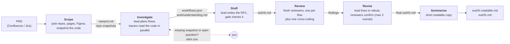

# rfc_agent

> **Pipeline (Scope → Summarize, `uv run rfc`)** — architecture and flow diagrams: **[docs/HLD.md](docs/HLD.md)**.
>
> **New user?** In Claude Code, say "Set up rfc-agent by following [INSTALL.md](INSTALL.md)". Claude does the rest.

RFC-generation pipeline: **PRD → grounded Tech RFC**. Each stage runs headless Claude Code agents with a
tightly scoped tool set; deterministic Python gates check the output between stages.

## One command

```
/rfc-agent:rfc --prd <confluence url>                  # in Claude Code: progress and every pause shown there
uv run rfc --prd <confluence url> [--jira KEY]         # in a terminal
```

Runs Scope → Summarize in order (scope · plan, trace, integrate · write + gate · review · fix · readable copy). Rerunning
the same command resumes; `--from N` restarts at a stage. Read **`out/rfc.readable.md`** first; `out/rfc.md` is the
full RFC with citations. Options: `uv run rfc --help`. The stages, one by one:

## How it works

You give it a PRD. It reads the code of the repos the PRD touches and writes a tech RFC in which every statement
about today's code points to a file and line. Six stages run in order; each one hands files to the next, and a
deterministic Python gate checks the output before the next stage starts.



| Stage | What happens | Main output |
|---|---|---|
| Scope | Fetches the PRD, you confirm repos / pages / Figma sections, repos are snapshotted read-only | `raw/prd.md`, repo snapshots |
| Investigate | A lead agent splits the PRD into flows; tracer agents follow each flow through the code in parallel; the lead integrates the facts | `work/flows.json`, `work/understanding.md` |
| Draft | The same lead writes the RFC; gates check coverage, structure, citations, secrets and Mermaid | `out/rfc.md` |
| Review | Independent reviewers (one per flow plus one cross-cutting) check the RFC | review findings |
| Revise | The lead fixes the findings (or disagrees with evidence), the gate re-runs, reviewers confirm | updated `out/rfc.md` |
| Summarize | A concise copy of the final RFC | `out/rfc.readable.md` |

Pipeline diagrams in more detail: [docs/HLD.md](docs/HLD.md).

## Installing

Follow **[INSTALL.md](INSTALL.md)**. It covers the prerequisites (Claude Code, access to your Confluence / Jira and
code host), installing the plugin, and first-time setup. The shorter "Setup" section further down is for
people working from a checkout.

## The stages

**Scope** (`python -m rfc_agent.scope`, or `/rfc-agent:scope` in Claude Code)
fetches the PRD, settles repos / pages / Figma sections in one confirm step, and snapshots the repos.
Everything it does, every decision rule and every edge case: **[docs/SCOPE.md](docs/SCOPE.md)**.
**Investigate** (`python -m rfc_agent.investigate --run-dir <run>`, or `/rfc-agent:investigate`) plans the flows, traces them
through the code with parallel agents and integrates the facts: **[docs/INVESTIGATE.md](docs/INVESTIGATE.md)**.
**Draft** (`python -m rfc_agent.draft --run-dir <run>`, or `/rfc-agent:draft`) has the same lead write the RFC
(`out/rfc.md`), then gates it (coverage, structure, CHANGE blocks, secrets, Mermaid lint; citations are checked as
it writes): **[docs/DRAFT.md](docs/DRAFT.md)**.
**Review** (`python -m rfc_agent.review --run-dir <run>`, or `/rfc-agent:review`) reviews the RFC with one fresh
reviewer per flow plus a cross-cutting one, in parallel: **[docs/REVIEW.md](docs/REVIEW.md)**.
**Revise** (`python -m rfc_agent.revise --run-dir <run>`, or `/rfc-agent:revise`) has the lead fix the findings, re-runs
the gate and has reviewers confirm, up to two rounds: **[docs/REVISE.md](docs/REVISE.md)**.
**Summarize** runs right after Revise (or `python -m rfc_agent.summarize --run-dir <run>`): a concise, human-readable copy of
the final RFC, `out/rfc.readable.md` — not reviewed: **[docs/SUMMARIZE.md](docs/SUMMARIZE.md)**.

## Harness

The repo also holds an agent-agnostic, workflow-agnostic harness. Its one workflow today is QA testing
(`harness run testing`). The kernel (`src/harness/`) owns the stage lifecycle, engine adapters, containment
policy, feature flags and observability; a workflow (`src/workflows/<name>/`) owns only its stages, gates and
vocabulary. The RFC pipeline above does not run on it.

```
$ uv run harness --help
usage: harness [-h] {run,flags,engines,workflows,doctor,record} ...

Run agent workflows on the agnostic harness kernel.

positional arguments:
  {run,flags,engines,workflows,doctor,record}
    run                 run a workflow
    flags               list/explain feature flags
    engines             list engine adapters with their doctor status
    workflows           list discovered workflows
    doctor              preflight: config, engines, MCP servers stages
                        reference
    record              build a replay recording from a finished run dir

options:
  -h, --help            show this help message and exit
```

One workflow is discovered today:

```
$ uv run harness workflows
WORKFLOW  PIPELINE                                                                            DESCRIPTION
--------  ----------------------------------------------------------------------------------  ------------------------------------------------------------
testing   sources -> generate_cases -> render_xlsx -> evaluate -> store_cases -> derive_spec  QA suite generation, evaluation, storage and backend executi
```

### Worked examples

Swapping the engine, globally or per stage — an argument, never a code edit:

```bash
# every stage on Pi; evaluate stays on Claude Code
uv run harness run testing --feature TASK-29354 --rfc-run-dir ~/rfc-runs/TASK-29354 --engine pi --stage-engine evaluate=claude-code
```

Turning a stage off and choosing a storage backend, for the testing workflow:

```bash
# skip the xlsx render (the JSON artifact is canonical), and upsert into Kiwi instead of local JSON
uv run harness run testing --feature TASK-29354 --rfc-run-dir ~/rfc-runs/TASK-29354     --disable-stage render_xlsx --set testing.storage=kiwi
```

Asking the harness what it can be told to do — the surface an agent drives:

```bash
uv run harness flags --json          # every flag with type, default, scope, owner, env var and help
uv run harness flags --explain engine
uv run harness engines               # adapters + their doctor verdict
uv run harness doctor                # config, engines, and the MCP servers each stage references
```

Every toggle is a registered flag with help text, resolved `CLI > env > config > workflow > default`, and
every run writes the resolved set to `<run_dir>/flags.json`. `--json` is available wherever an agent
consumes the output. Exit codes are unchanged and remain the contract: **0** ok or operator quit,
**1** pipeline/config error, **2** gate failure, **3** engine failure.

### Engines

`claude-code` (default) is the existing `claude -p` primitive wrapped as an adapter — the path that months
of A/B numbers and the pre-existing test suite validate. `pi` drives
[`@earendil-works/pi-coding-agent`](https://github.com/earendil-works/pi) as a `pi --mode json` subprocess.
`replay` re-emits a recorded trace for parity runs and benchmarks. Selection is by name through the `engine`
and `stage_engines` flags. Pi has no MCP support, so a stage that names MCP servers is refused **before any
spend**, with the `--stage-engine` override that fixes it in the error message.

### Documentation

Start at **[docs/harness/README.md](docs/harness/README.md)**, which has a reading order for operators,
for agents driving the harness, and for contributors adding a workflow or an engine. The set:
[ARCHITECTURE](docs/harness/ARCHITECTURE.md) ·
[ENGINES](docs/harness/ENGINES.md) ·
[BENCHMARKS](docs/harness/BENCHMARKS.md).

## Setup

> Full operator prerequisites (auth, seats, service accounts, failure signatures): **[SETUP.md](SETUP.md)**.

```bash
uv sync
mkdir -p ~/.config/rfc-agent
cp config.example.json ~/.config/rfc-agent/config.json && chmod 600 ~/.config/rfc-agent/config.json   # fill it in
```

**Contributing from a checkout?** Run `bash scripts/security/setup.sh` once. It installs the scanners the security
gate uses and turns on the pre-push hook (`make install-hooks`), so a push is scanned for secrets and internal names
before it leaves your machine. See [scripts/security/SECURITY.md](scripts/security/SECURITY.md).

**Config lives OUTSIDE the plugin**, in `~/.config/rfc-agent/config.json`: an installed plugin is replaced on every
update, and a config inside it once leaked credentials into plugin cache copies. It holds everything you supply —
team values (Atlassian site, fleetlens URL, product surfaces, service inventory, Langfuse host) and your own
(`REPOS_ROOT`, `RUNS_ROOT`, Langfuse keys, tokens). The harness's own working values ship read-only in
`config.harness.json`; any key you set in your config.json wins, and env vars win over both. Nothing org-specific
ships in the plugin. Details: SETUP.md §3.

## Install as a Claude Code plugin

The repo root is also a plugin (`.claude-plugin/` + `commands/`). From a **local checkout** (recommended —
config.json survives updates; a git-installed plugin cache is wiped on update):

```
/plugin marketplace add /path/to/rfc_agent
/plugin install rfc-agent@rfc-agent-marketplace
```

Then `/rfc-agent:setup` once, and `/rfc-agent:rfc --prd <url>` per RFC (deliverables land in
`$RUNS_ROOT/<jira-key-or-slug>/`, default `~/rfc-runs/`). `/rfc-agent:doctor` preflights
config/binaries/MCP/repos. Installed from a **directory** source, the plugin serves the checkout live — but
Claude Code caches the manifest, so after a version bump reload the session (or re-add the marketplace).

## Tests

`uv run pytest` — stages, gates, the harness kernel and the testing workflow (fake engines, no model calls).
