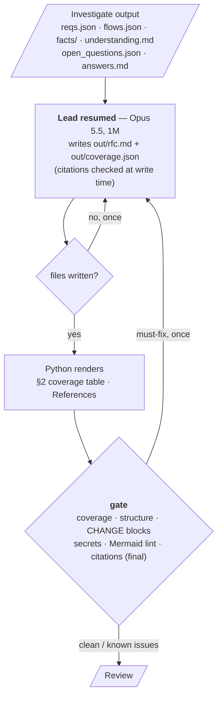
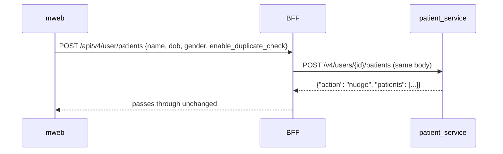

# Draft

Draft turns Investigate's grounded understanding into **one RFC document**. The lead that planned and
integrated Investigate writes it — warm, with everything already read — and Python renders the parts that must
be exact (the coverage table and the references), then gates the result.

**Run it** (after Investigate):

```
/rfc-agent:draft --run-dir <run dir>                        # in Claude Code: progress relayed here
uv run python -m rfc_agent.draft --run-dir <run dir>        # in a terminal  [--fresh to write again]
uv run python -m rfc_agent.draft --run-dir <run dir> --check-only   # re-run only the gate
```

Code: `src/rfc_agent/draft/` — `cli.py` · `coverage.py` (check + rendering) · `gate.py` · `prompts/write.md`. It
reuses Investigate's agent runner, hook and progress. Tests: `tests/rfc/test_draft.py` (including an end-to-end run
with a fake `claude`) and `tests/rfc/test_draft_gate.py` (each gate check: fixed → clean; unfixable → known issues).

---

## Contents

1. [Shape](#shape)
2. [Inputs](#inputs)
3. [Who writes, and what it may do](#who-writes-and-what-it-may-do)
4. [The document](#the-document)
5. [Coverage as data](#coverage-as-data)
6. [The prompt](#the-prompt)
7. [The gate](#the-gate)
8. [Configuration](#configuration)
9. [Output](#output)
10. [Progress](#progress)
11. [Failure handling and edge cases](#failure-handling-and-edge-cases)
12. [Handoff to Review](#handoff-to-review)

---

## Shape

```
Investigate output ──► Draft: lead resumed (same Opus session as 1a/1c)
                     writes out/rfc.md + out/coverage.json
                   ──► Python: render coverage table + References → the gate (one fix round)
                   ──► Review (known issues and flags first)
```



---

## Inputs

All on disk from Investigate (and already in the lead's context when it is resumed):

| Input | Used for |
|---|---|
| `work/reqs.json` | Coverage; the requirements the design answers |
| `work/flows.json` | One design section per flow; the hops |
| `facts/T*.md` | Current state, shapes, callers, existing behaviour — with citations |
| `facts/ui-*.md` | States, actions, server-driven copy, not-designed REQs, conflicts |
| `work/understanding.md` | Cross-flow constraints the design must visibly handle; settled conflicts |
| `work/open_questions.json`, `work/answers.md` | Open questions; answers are treated as fact |
| `scope.json` | Repos at their snapshot commits (References) |
| `raw/prd.md`, `raw/links.md` | Context & problem; References |

---

## Who writes, and what it may do

| | Rule | Why |
|---|---|---|
| **Writer** | The lead, **resumed** from 1c (`logs/lead.session`) — Opus 5.5, 1M context | It already read the PRD, the plan and every facts file, and integrated them: no re-reading, no lossy handoff |
| **Fallback** | Session can't be resumed → a fresh lead that first reads `work/` and `facts/` | The files hold everything; the 1M window fits them |
| **Code access** | `Read` / `Grep` / `Glob` on `_snap/` only to settle a doubt — soft cap ~20 reads, counted and logged, not blocked | The facts are trusted; the lead does not re-explore |
| **No new investigations** | No tracers, no gap-filling agents. A gap becomes an open question | Investigate is where investigation happens |
| **Writes** | Only `out/rfc.md` and `out/coverage.json` (the Investigate hook confines writes) | |
| **Tools** | Same as the lead in Investigate: no Bash, no Agent, no web; context layer read-only | |

---

## The document

One file, `out/rfc.md`. The API contract and the implementation plan are **sections**, not separate files: one
document cannot contradict itself across files.

**Style:** plain words, numbered steps, tables; every sentence tells the reader what to build or why.
**Size:** aim for 25–40 KB (stated in the prompt; no hook enforces it).

```
# RFC: <feature>
| Jira | Status | Repos (commit) | PRD |                 ← header table
> TL;DR (≤ 3 sentences: the problem, the chosen mechanism, the one number that matters)

## 1. Context & problem              why now; no solutioning
## 2. Requirements coverage          heading only — the table is rendered by Python from out/coverage.json
## 3. Options                        2–3 genuinely different overall approaches (table) → Recommendation
## 4. Design                         one subsection per flow
## 5. API contract                   every new or changed endpoint
## 6. Implementation plan            CHANGE blocks
## 7. Rollout, monitoring, risks
## 8. Open questions
## References                        rendered by Python
```

The full target shape, with the reasoning behind each section, is in [RFC_SHAPE.md](RFC_SHAPE.md).

### 3. Options → Recommendation (always present)

```
## 3. Options
| Option | Idea | Pros | Cons |
|---|---|---|---|
| A. Gate in the service, opt-in flag | … | … | … |
| B. Check in the BFF before create | … | … | … |
| C. Client-side check only | … | … | … |

## Recommendation: A
- ≤ 4 reasons, judged in this order: scalability → loose coupling → fit with existing code →
  operational simplicity → the PRD's constraints
```

Always 2–3 overall approaches. Smaller choices *inside* the recommended design (e.g. which field
discriminates the new behaviour) are stated where they apply, in the flow's Change steps, with a one-line
reason.

### 4. Design — one subsection per flow

````
### 4.1 F1 Create patient

**Current state**
- create merges a same-name patient (DOB within 5 yrs) instead of creating one
  (patient_service/app/managers/patient/patient_manager.py:291)
- svc_a and diagnostics call this route and read response["patient"] (svc_a/app/managers/patient.py:169)
**Change**
1. patient_service — …
2. BFF — …
3. mweb — …
**Edge cases & failure behaviour**
- …
````

| Part | Rule |
|---|---|
| Diagram | **Sequence diagram**: calls and responses in order, matching how flows were traced |
| Current state | ≤ 5 bullets; **each cites `repo/path:line` inline**. This is where the facts land |
| Change | Numbered steps: who (which repo) does what, with which data. Cites code only when a step depends on existing code |
| Constraints | Every cross-flow constraint from `understanding.md` (seams, shared callers) is visibly handled in some flow's Change or Edge cases |

### 5. API contract

Every new or changed endpoint (internal ones included):

```
### POST /v4/users/{user_id}/patients   (patient_service — changed)
Request   JSON example; new fields marked
Response  JSON example per outcome (created / nudge / …) — exact nesting; say what each existing caller reads
Errors    | status | code | when |
Callers   who calls it today and whether they are affected
```

### 6. Implementation plan — CHANGE blocks

```
### CHANGE-1 patient_service: opt-in duplicate gate on create            [REQ-3, REQ-4]
- repo: patient_service
- files: app/managers/patient_crud_manager.py:236 (modify) · app/utils/name_matching.py (modify) ·
         tests/test_duplicate_gate.py (new — no line number)
- what: numbered steps
- depends on: —
- verify: the test / check that proves it, incl. the unchanged response for callers that don't opt in
```

Numbered in the order they should be built; `depends on` names earlier CHANGEs. This is the shape a later
ticketing step (epic → stories) can consume directly.

### 8. Open questions

| id | question | blocks | suggested answer | owner |
|---|---|---|---|---|

Starts from `open_questions.json`; the lead adds any new ones found while writing, removes ones the design
settled, and keeps answered ones out (they are facts now).

### References (rendered by Python)

PRD and Jira links, linked Confluence pages that were fetched, Figma links, and every repo with the commit its
snapshot was taken at — so every `path:line` in the document can be opened at the exact code it cites.

---

## Coverage as data

The lead does **not** hand-write the coverage table. It writes `out/coverage.json`:

```json
{"REQ-1":  {"status": "covered",  "sections": ["4.1"]},
 "REQ-4":  {"status": "assumes",  "sections": ["4.1"], "question": "Q2", "note": "assumes the BFF passes fields through"},
 "REQ-9":  {"status": "deferred", "note": "phase 2 per PRD §8"},
 "REQ-12": {"status": "open",     "question": "Q1"}}
```

| Status | Rendered as | Requires |
|---|---|---|
| `covered` | ✅ Covered (§4.1) | `sections` — headings that exist |
| `assumes` | 🟡 Covered, assumes Q2 (§4.1) | `sections` + a `question` that exists in §8 |
| `deferred` | ⏸ Deferred — note | `note` (why) |
| `open` | ❓ Open — Q1 | a `question` that exists in §8 |

**Python checks** that every REQ in `reqs.json` is present, that `assumes`/`open` name a question id that
appears in §8, and that every section number exists as a heading. Then it **renders the table** under the §2
heading (`id · summary · status`) — no markers in the document. With `REQ_GRANULARITY = fine`, rows are grouped
under their `parent` REQ. Generating the table from data keeps it consistent with the Open Questions section.

---

## The prompt

The prompt is [prompts/write.md](../src/rfc_agent/draft/prompts/write.md), sent when the lead is resumed after
Investigate. In short it tells the lead:

- everything it needs is in `reqs.json`, `flows.json`, `facts/`, `understanding.md`, `open_questions.json` (and
  `answers.md`, which is fact); read code only to settle a doubt (about 20 reads at most); do not start new
  investigations — a gap is an open question;
- write `out/rfc.md` in the shape above, plain words, 25–40 KB;
- write `out/coverage.json` with one entry per REQ;
- make every constraint in `understanding.md` visibly handled in the design.

---

## The gate

Draft ends with a **gate**; there is no separate checking stage. Two layers, both Python-only.

### 1. While the lead writes: citations checked at write time

The Investigate agent hook runs on every `Write`/`Edit` of `out/rfc.md` (`check_files`): every `repo/path:line`
must resolve in the snapshots, "not found" claims are re-checked with `rg`, and a cited line that doesn't
mention the code identifier its bullet names is reported as *"wrong line?"*. The feedback reaches the lead
immediately, so it fixes citations while the code is still in front of it — no resume round. Citations written
as `_snap/<repo>/…` are checked too and reported, so the document uses the repo-relative form readers can open.

### 2. After the lead writes: the gate

```
lead done → render §2 table + References → gate checks
    ├─ clean ───────────────────────────────────────► Review
    └─ must-fix ─► lead resumed once with the list ─► re-render ─► re-check
                     ├─ fixed ─────────────────────────────────► Review
                     └─ still wrong ─► known issues in out/check.json ─► Review sees them first (run continues)
```

| # | Check | Result | Why |
|---|---|---|---|
| 1 | **Citations resolve** — every `repo/path:line` with a repo in scope: file exists in that repo's snapshot, line (or range) within the file | Must-fix — normally caught at write time; here a final assertion | A broken path misleads every reader |
| 2 | **"Not found" claims** — lines saying something is absent about a backticked identifier: `rg` across all in-scope snapshots; a hit means the claim is false | Must-fix — normally caught at write time; here a final assertion | A false absence produces a wrong design |
| 3 | **Coverage** — every REQ in `coverage.json`, valid status, `assumes`/`open` questions exist in §8, sections exist as headings | Must-fix | Every REQ must have a valid status |
| 4 | **Structure** — sections §1–§8 present, a `Recommendation` heading, and **one design subsection (§4.n) per flow in `flows.json`** | Must-fix | A missing flow is a missing design |
| 5 | **CHANGE blocks** — every `depends on` names a CHANGE that exists; no dependency cycles; files marked `(modify)` exist in the snapshot; files marked `(new)` do **not** already exist | Must-fix | A "new" file that already exists means the plan misread the code |
| 6 | **Secrets** — API keys, tokens, passwords, private keys, credential-bearing URLs copied from code or config | Must-fix | The RFC is shared with other people |
| 7 | **Mermaid lint** (below) | Must-fix | A syntax error is objectively wrong and cheap to fix while the lead is warm |
| 8 | Q ids and REQ ids mentioned in the text exist (§8 / `reqs.json`) | Flag | Usually a typo, not a design error |
| 9 | "Current state" bullets without a citation | Flag | The design rule says they cite; the reviewer judges |
| 10 | Size outside the target (25–40 KB); TL;DR longer than 3 sentences | Flag | Readability, not correctness |

#### Mermaid lint (no renderer)

The gate runs a cheap lint. It does not render diagrams.

| Rule | Example of a failure |
|---|---|
| Every ```` ```mermaid ```` fence is closed | unterminated block |
| The block starts with `sequenceDiagram` | `flowchart TD` in a design section |
| Message lines are well formed: `A->>B: text`, `A-->>B: text`, `A->B`, `A-xB`, `A-)B` | `A -> > B text` |
| Participants used in messages are declared (`participant X as …` / `actor X`) or used consistently as bare names | `T->>X:` where `X` was never declared |
| `alt`/`opt`/`loop`/`par`/`rect`/`critical` blocks are closed with `end` | unbalanced `alt … else` without `end` |
| No empty block | ```` ```mermaid ```` immediately followed by ```` ``` ```` |

#### Secrets patterns

AWS keys (`AKIA…`), `-----BEGIN … PRIVATE KEY-----`, bearer/JWT tokens (`eyJ…` three segments), generic
`(api[_-]?key|secret|token|password)\s*[:=]\s*['"][^'"\s]{12,}`, and URLs with `user:password@`. Values that
are obvious placeholders (`<token>`, `xxx`, `***`, `changeme`) are ignored.

### The fix round

- **Who:** the lead, resumed (same session), writes only `out/rfc.md` and `out/coverage.json`.
- **Prompt:** *"The gate found these problems … Fix each one in place — don't rewrite untouched sections (the
  §2 coverage table and References are regenerated) — then reply done:"* followed by the must-fix list,
  grouped by check.
- **Once**, and only if the RFC changed since the last fix round (content hash). Then the table and References
  are re-rendered and everything is re-checked. Must-fix items still wrong become **known issues**: the run
  continues and the reviewer sees them first.

### Re-running the gate

`python -m rfc_agent.draft --run-dir <dir> --check-only` (e.g. after hand-editing `out/rfc.md`): no writing,
just the gate — with a fix round only if the RFC changed since the last one.

### Not checked by the gate

- **JSON examples** in the API contract — not parsed (they often contain placeholders; the reviewer reads them).
- **Rendering Mermaid** — only the lint above.
- **Whether a citation supports its claim** beyond the identifier check, design quality, missing edge cases —
  the Review stage's job.

---

## Configuration

`~/.config/rfc-agent/config.json`, section `DRAFT`:

| Key | Default | |
|---|---|---|
| `LEAD_MODEL` / `LEAD_EFFORT` | Investigate's lead (`claude-opus-5-5[1m]` / high) | the same session is resumed |
| `TIMEOUT_S` | 1200 | |
| `SIZE_TARGET_KB` | "25–40" | stated in the prompt only |
| `CODE_READS` | 20 | soft cap, logged |

---

## Output

| Path | Contents |
|---|---|
| `out/rfc.md` | The RFC (with the rendered §2 table and References) |
| `out/coverage.json` | REQ → status, sections, question |
| `out/check.json` | Gate result: known issues and flags |
| `logs/draft.json` | Time, cost, size, code reads, coverage check results |
| `logs/investigate.lead.*.stream.jsonl` | The lead's stream (same agent label; Draft appends a new run) |

---

## Progress

Same mechanism as Investigate: milestones in `logs/progress.jsonl`, relayed by the Claude Code command —
*"Draft: the lead is writing the RFC"* · *"RFC written: 34 KB, 4 flows, 9 CHANGEs, 22 REQs (18 covered, 2
assume Q1/Q2, 1 deferred, 1 open)"* · *"coverage.json: 2 problems → back to the lead once"*.

---

## Failure handling and edge cases

| Case | Behaviour |
|---|---|
| Lead session can't be resumed | Fresh lead; prompt starts with "read work/ and facts/ first" |
| `rfc.md` or `coverage.json` not written | Resume once asking for the missing file; still missing → stop with the error |
| `coverage.json` invalid after one fix | Rendered as far as possible; still-wrong items become known issues for Review |
| A REQ the design can't meet | `open` with a question, or `deferred` with a note — never silently dropped (Python checks every REQ is present) |
| A flow was `UNTRACED` in Investigate | Its design section says so; its REQs are `assumes`/`open` with a question |
| Size far over 40 KB | Logged; not blocked (reviewers judge readability) |
| Timeout | Partial files kept; one resume asking to finish |

---

## Handoff to Review

Review reads `out/rfc.md`, `out/coverage.json` and `out/check.json` — known issues and flags first.
