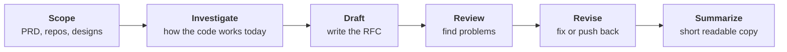
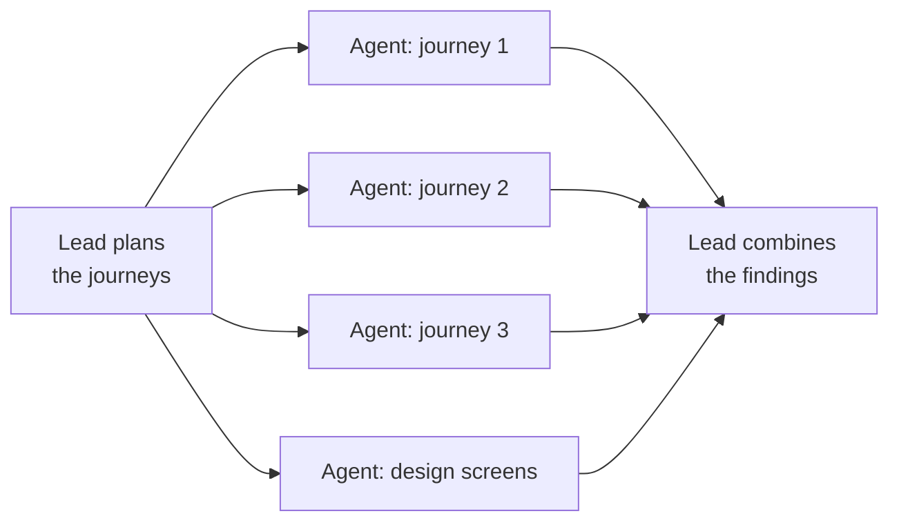
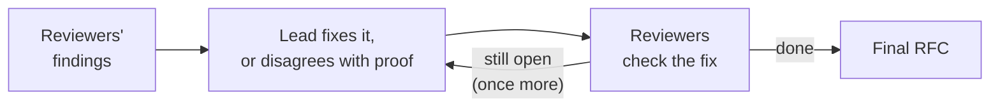

# rfc-agent — how it works

Give it a PRD. It reads the code of the repos the PRD touches and writes a tech RFC where every statement about
today's code points to the exact file and line.

```
uv run rfc --prd <confluence link>
```

---

## The whole thing in one picture



You get two files at the end: the full RFC (`out/rfc.md`, with citations) and a short version for people who
just want the gist (`out/rfc.readable.md`).

Each stage runs headless Claude Code agents with a tightly scoped tool set. Deterministic Python checks the
output between stages, so a stage never starts from broken input.

---

## The stages

### Scope — [SCOPE.md](SCOPE.md)

Collects everything once, so nothing later has to fetch anything.

- Downloads the PRD from Confluence.
- Suggests which repos are involved (from the context layer and the PRD itself). **You confirm the list.**
- If the PRD links a Figma design, you pick which screens matter and they get exported.
- Takes a read-only copy of each repo at its default branch. Your own checkouts are never changed.

### Investigate — [INVESTIGATE.md](INVESTIGATE.md)

One senior agent (the **lead**) reads the PRD and splits the work into user journeys, e.g. "create patient",
"edit patient". Then several smaller agents work **at the same time**, one per journey, each following that
journey through the code. Another reads the design screens. The lead then puts their findings together.



If a journey crosses a repo that has no snapshot, you are asked before the agents start. With `--ask`, you can
also answer the open questions the lead could not settle from code.

### Draft — [DRAFT.md](DRAFT.md)

The same lead writes the RFC: problem, options and a recommendation, the design for each journey, API changes,
the implementation plan, rollout and open questions. A quick automatic check then catches broken file
references, missing sections and secrets before anyone reviews it. The exact document shape is in
[RFC_SHAPE.md](RFC_SHAPE.md).

### Review — [REVIEW.md](REVIEW.md)

Fresh reviewers, who didn't write the RFC, check it against the code: one per journey plus one for the
document as a whole. They work at the same time.

### Revise — [REVISE.md](REVISE.md)



At most two rounds. Anything still unresolved is listed openly in the RFC rather than hidden.

### Summarize — [SUMMARIZE.md](SUMMARIZE.md)

Writes a short, easy-to-read copy of the final RFC.

---

## When it asks you something

| When | What you decide |
|---|---|
| Scope (always) | Which repos, pages and Figma screens to use |
| Investigate, if needed | Which missing repo snapshots to retry; with `--ask`, the open questions the code couldn't answer |
| Review, optional | Which findings to fix (only with `--ask-review`) |

Run from Claude Code (`/rfc-agent:rfc`), these appear as clickable choices.

---

## Design choices that matter

| Choice | Why |
|---|---|
| One lead keeps its understanding from Investigate through Revise | Nothing is lost in a handoff, and the lead already knows why each design choice was made |
| Code is read from a local, read-only snapshot | Reads are fast, consistent across agents, and never touch your working tree |
| Only the Figma screens you pick are exported | Keeps the design input small and relevant |
| Citations are checked the moment an agent writes them | A wrong file reference is fixed while the code is still in front of the agent |
| Parallel agents orchestrated by Python | Guaranteed parallelism, per-agent timeouts, and retrying a single failed agent |
| Reviewers are fresh sessions that never see the lead's reasoning | They can catch what the lead missed rather than repeat it |

---

## Where things are

| | |
|---|---|
| Final RFC | `out/rfc.md` |
| Short copy | `out/rfc.readable.md` |
| Review and fixes | `review/review.md`, `review/fixes.md` |
| Run folder | `~/rfc-runs/<prd id>/` (set by `RUNS_ROOT`) |

If a run stops, run the same command again; it continues where it stopped (`--from <stage>` restarts at a
stage).

More on each stage: [Scope](SCOPE.md) · [Investigate](INVESTIGATE.md) · [Draft](DRAFT.md) ·
[Review](REVIEW.md) · [Revise](REVISE.md) · [Summarize](SUMMARIZE.md) · [Observability](OBSERVABILITY.md) · [Feedback](FEEDBACK.md)
