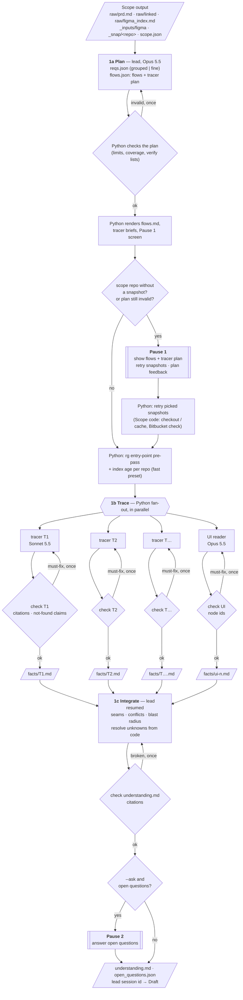

# Investigate

Investigate turns Scope's inputs into a **grounded understanding** of the feature: the requirements, every
journey traced through the real code, and the UI states. Draft then writes the RFC from that understanding
without exploring code again.

**Run it** (after Scope):

```
/rfc-agent:investigate --run-dir <scope run dir>                      # in Claude Code: progress + pauses here
uv run python -m rfc_agent.investigate --run-dir <scope run dir>      # in a terminal
    [--preset balanced|fast] [--req-granularity grouped|fine] [--ask] [--yes] [--confirm-file] [--fresh]
```

Rerunning the same command resumes: finished steps and agents are kept (`--fresh` redoes everything).

Code: `src/rfc_agent/investigate/` — `cli.py` orchestration · `agent.py` runner · `hook.py` write confinement,
budget nudge and write-time citation checks · `plan.py` plan check and rendering · `checks.py` · `ui.py` ·
`repo_info.py` · `pauses.py` · `progress.py` · `prompts/`. Tests: `tests/rfc/test_investigate.py` (including an
end-to-end run with a fake `claude`).

---

## Contents

1. [Shape](#shape)
2. [Flow diagram](#flow-diagram)
3. [Inputs](#inputs)
4. [1a — Plan (lead)](#1a--plan-lead)
5. [Pause 1 — missing snapshots and plan problems](#pause-1--missing-snapshots-and-plan-problems)
6. [1b — Trace (tracers and UI readers)](#1b--trace-tracers-and-ui-readers)
7. [1c — Integrate (lead)](#1c--integrate-lead)
8. [Pause 2 — open questions](#pause-2--open-questions)
9. [How many agents](#how-many-agents)
10. [Presets](#presets)
11. [Configuration](#configuration)
12. [Models, tools and containment](#models-tools-and-containment)
13. [Output](#output)
14. [Progress in Claude Code](#progress-in-claude-code)
15. [Failure handling and edge cases](#failure-handling-and-edge-cases)
16. [Handoff to Draft](#handoff-to-draft)

---

## Shape

| | 1a Plan | 1b Trace | 1c Integrate |
|---|---|---|---|
| Who | Lead (Opus 5.5) | Tracers as planned by the lead (Sonnet 5.5) + UI readers (Opus 5.5), **in parallel** | The same lead, resumed |
| Looks at | PRD, Figma screen list, the context layer's **map** (services, interfaces, relationships) | **Code**, deep, one flow each | All tracer findings side by side + spot checks |
| Answers | "Which journeys does this PRD touch, through which services?" | "How does *this* journey work today, hop by hop?" | "Do the journeys fit together, and what is still unknown?" |
| Output | `reqs.json`, `flows.json` (flows + tracer plan); Python renders `requirements.md`, `flows.md`, tracer briefs | `facts/<tracer>.md`, `facts/ui*.md` | `understanding.md`, `open_questions.json` |

**Who orchestrates:** Python. The lead is a `claude -p` session whose id is saved. Python runs the tracers as
separate `claude -p` processes in parallel, then **resumes** the lead's session (`--resume`), so the lead
keeps its context across the fan-out. Python orchestrates, rather than the lead's `Agent` tool, because it
guarantees parallelism, per-agent timeouts, retrying one failed tracer, and cost per agent.

**Human pauses:** at most two, both **before any writing**, both skipped when there is nothing to ask. Both
use Scope's confirm mechanism (selection questions under the Claude Code command, the numbered list in a
terminal, files in between).

---

## Flow diagram



---

## Inputs

Everything comes from Scope's run folder. Investigate never fetches PRDs or asks for scope again.

| Input | Used by |
|---|---|
| `raw/prd.md`, `raw/jira.md`, `raw/linked/*` | 1a requirements |
| `raw/figma_index.md` | 1a (screen names → where flows start), UI readers |
| `_inputs/figma/<key>-<node>/*.png` + `.json` | UI readers; lead spot checks |
| `scope.json` → `repos[]` (`path`, `source`, `branch`, `sha`) | Everyone: which snapshot to read, which repos are `context-index-only` |
| Context layer (MCP, `fleetlens`) | The map (services, interfaces, relationships) in 1a; endpoints and call graphs in 1b |

### What the context layer provides

The context layer is **fleetlens** (config `MCP.mcpServers.fleetlens`): one index over the whole fleet of
services, their interfaces, code symbols and the relationships between them.

| Tool | What it gives |
|---|---|
| `get_service_graph`, `list_services`, `get_service_relationships` | Every service and every edge (calls / publishes_to / shares_channel), each with a confidence and the evidence behind it |
| `discover_services`, `discover_interfaces` | Search by meaning over generated summaries |
| `list_interfaces` | One service's endpoints and queues, with their handlers |
| `get_endpoint_call_graph`, `get_callers`, `get_callees`, `find_symbol`, `get_symbol` | The call graph: an endpoint into its handler and what it calls, blast radius, symbol locations (path + line) |
| `get_index_info` | When the index was built |

Consequences built into the design:

- **Code tools only help for repos with a code index.** Python checks each repo and the brief says
  "code index: yes/no"; agents skip the code tools where it is "no".
- **There are no stored contracts.** Request and response shapes come from the code.
- **A repo without a snapshot gets almost nothing at code level.** Scope's `context-index-only` is not a
  usable fallback for tracing, so Pause 1 shows such repos as needing attention instead of hiding them.
- **The index is a snapshot.** Python gives every agent each repo's **index age**: the index's build date
  versus the snapshot's last commit. **Where they disagree, the code wins.**

---

## 1a — Plan (lead)

The lead reads the inputs and asks the context layer **map-level** questions only. It does not trace code in
depth; that is 1b's job. The prompt is [prompts/lead_1a.md](../src/rfc_agent/investigate/prompts/lead_1a.md).

### Requirements

Granularity is config (`INVESTIGATE.REQ_GRANULARITY`), so both modes can be compared on the same PRD:

| | `grouped` (default) | `fine` |
|---|---|---|
| Unit | One REQ per capability-level behaviour | One REQ per testable statement |
| Typical count | ~15–30 | ~50–100 |
| Fields | `id`, `priority` (must/nice), `text`, `quote` (the PRD line), `flows` | Same, plus `parent` (the grouped REQ it belongs to) |

Same `reqs.json` schema either way, so Draft's coverage check and the RFC's coverage table work unchanged.

```json
{"granularity": "grouped",
 "requirements": [
   {"id": "REQ-4", "priority": "must", "text": "Nudge when a new patient's name is similar to an existing one",
    "quote": "If the user enters a name similar to an existing patient, show a nudge …", "flows": ["F1"]}]}
```

Requirements with no code path (copy, layout, analytics wording) get `"flows": []`; the UI readers and the
lead cover them.

### Flows and the tracer plan → `work/flows.json`

A **flow** is one end-to-end journey: where the user starts it (screen / action), every hop (FE → BFF →
service → store), the repos it crosses, and the REQs it carries. The lead builds flows from:

- Figma screen names and the PRD's journey descriptions — where a flow starts;
- `discover_interfaces(service, capability)` per in-scope service — the entry points;
- `get_service_relationships` — the hops between services;
- **at most 15 code reads** (`Read`/`Grep` on `_snap/`), only to anchor an entry point (a route, a screen
  component). Deep reading is the tracers' job, which keeps 1a short. Python counts these reads in the
  lead's stream and logs an overrun; it does not block mid-plan.

The lead writes **JSON only**. Python validates it and renders everything humans and tracers read:
`work/flows.md`, the Pause 1 screen, and one brief per tracer (`work/briefs/<tracer>.md`). The lead never
formats the same plan for three audiences.

Example (abridged):

```json
{
  "flows": [
    {
      "id": "F1",
      "name": "Create patient",
      "trigger": {"surface": "mweb", "screens": ["Add patient"], "action": "tap Save on the add-patient sheet"},
      "reqs": ["REQ-3", "REQ-4", "REQ-7"],
      "hops": [
        {"n": 1, "repo": "web_app_vite", "what": "Add-patient form submits",
         "anchor": "PRD §6.2; Figma 'Add patient'", "confidence": "inferred"},
        {"n": 2, "repo": "gateway_bff", "what": "BFF POST /api/v4/user/patients",
         "anchor": "get_service_relationships(web_mobile) → gateway_bff", "confidence": "map"},
        {"n": 3, "repo": "patient_service", "what": "POST /v4/users/{user_id}/patients",
         "anchor": "interface:patient_service:create_patient", "confidence": "map"}
      ],
      "verify": [
        "What the create path does today when a same-name patient exists",
        "Exact response shape at each hop",
        "Every other caller of the create route and what it reads from the response"
      ],
      "ignore": ["Cart pricing and slots — same screens, not this PRD"]
    }
  ],
  "tracers": [
    {"id": "T1", "flows": ["F1"], "repos": ["web_app_vite", "gateway_bff", "patient_service"],
     "why": "create path end to end"},
    {"id": "T2", "flows": ["F2", "F4"], "repos": ["gateway_bff", "patient_service"],
     "why": "edit and select-existing share the same manager and BFF route"},
    {"id": "T3", "flows": ["F3"], "repos": ["patient_service"],
     "why": "suggestions are one endpoint"}
  ],
  "no_flow_reqs": ["REQ-12", "REQ-15"],
  "notes": "F1, F2 and F4 share the BFF hop."
}
```

| Field | Rule | Why |
|---|---|---|
| `flows[].hops[].anchor` + `confidence` | `map` (a context-layer id), `prd` (stated in the PRD / Figma) or `inferred` (the lead's guess) | You see at Pause 1 which hops are guesses; tracers treat `inferred` hops as "confirm or correct" |
| `flows[].hops[].repo` | Any repo or system, **including ones not in scope** (apps, gateways, external APIs) | Python diffs these against `scope.json`: hops outside scope are reported (`outside` milestone, `⚠ not in scope — not traced` in `flows.md`) and handed to 1c as untraced. **Scope's repos are final** — Investigate never offers to add a repo |
| `flows[].verify` | At least one item per flow | The lead's specific suspicions, handed to the tracer. This is how the lead's reading of the PRD steers the deep read |
| `flows[].ignore` | Optional | Keeps tracers off code the PRD doesn't touch |
| `tracers[]` | **The lead decides** how to divide the work: one tracer may cover several flows (`T2`), a flow may be split across tracers by repo (`fast`). `repos` limits where that tracer reads and must all be in scope. One-line `why` each | The lead knows which flows walk the same code |
| `no_flow_reqs` | Every REQ is in a flow or here | Requirements with no code path are covered by UI readers and the lead |

### Checks on the plan (Python, before Pause 1)

| Check | If it fails |
|---|---|
| Every REQ id exists in `reqs.json`; every REQ is in a flow or `no_flow_reqs` | Lead resumed once with the list |
| Every flow has at least one `verify` item | Same |
| At most `MAX_TRACERS` tracers | Same ("7 tracers, limit 6: merge flows that share code") |
| Every flow covered by at least one tracer; tracer ids unique; no empty tracer | Same |
| Each tracer's `repos` appear in the hops of its flows | Same |
| Still invalid after the one fix | **Stop at Pause 1** and show you the problem instead of guessing |

### Rendering (Python)

- `work/requirements.md` — readable table of `reqs.json`.
- `work/flows.md` — flows with hops, anchors and confidence, the tracer plan with each `why`, repos not in scope.
- `work/briefs/<tracer>.md` — what one tracer gets: its flows' triggers, hops, `verify` and `ignore`, the REQs
  they carry, its `repos` limit, and the facts template.

---

## Pause 1 — missing snapshots and plan problems

**Scope's repos are final.** Investigate never asks to add a repo: to change the repos, rerun Scope
(`/rfc-agent:scope`). Hops in repos outside scope are listed in one `outside` progress line ("Not traced
(outside the repos in scope): android app (F1); api_gateway (F2, F3)"), marked `⚠ not in scope — not traced`
in `flows.md`, and passed to the 1c lead as untraced.

**When:** a flow crosses a scope repo **without a snapshot** (`context-index-only`, so it cannot really be
traced), **or** the plan is still invalid after the lead's one fix. Otherwise skipped.

**Shows** (rendered from `flows.json`):

```
Flows (4) · Tracers (3, preset balanced, limit 6)
  T1  F1 Create patient                 mweb → gateway_bff → patient_service   "create path end to end"
  T2  F2 Edit + F4 Select existing      gateway_bff → patient_service          "share manager + BFF route"
  T3  F3 Name suggestions               patient_service                        "one endpoint"
  UI  1 reader · 41 screens
Repos in scope WITHOUT a snapshot:  ☐ gateway_bff — needed by F1, F2, F4
```

Picks: which snapshots to retry. You can also say a flow or the tracer plan is wrong (free text → the lead
revises `flows.json` once, and Python re-checks it).

**Then:** Python retries the picked snapshots with Scope's code (checkout or repo cache, Bitbucket check).
Unpicked ones stay in the flows as untraced hops. Only then do the tracers start — a tracer never waits for a
human.

---

## 1b — Trace (tracers and UI readers)

### Tracer

One per entry in the lead's tracer plan. Sonnet 5.5. The prompt is
[prompts/tracer.md](../src/rfc_agent/investigate/prompts/tracer.md); the output template is
[prompts/facts_template.md](../src/rfc_agent/investigate/prompts/facts_template.md), injected into the prompt
and read by the checker, so the two cannot drift apart.

**What it receives:**

```
prompt  = the tracer prompt (the same for every tracer)
        + work/briefs/<tracer>.md   ← rendered by Python from flows.json:
            flows covered, each with: trigger, hops (+ anchor, confidence), verify, ignore, REQs
            repos it may read (+ snapshot paths)
            index age per repo (index build date vs. snapshot's last commit)
            [fast] facts/<tracer>.entry.json — rg pre-pass: where each hop's route and entry function are
tools   = Read, Grep, Glob on _snap/<its repos> · context layer (read tools) · Write facts/<tracer>.md only
```

**Sources, per repo:** the snapshot (`Read`/`Grep` on `_snap/<repo>`) is the truth for current code **and the
main tracing tool**. The context layer adds what `Grep` can't see across repo boundaries: endpoints, callers
and call graphs (where a code index exists). The index is a snapshot: **where it disagrees with the code, the
code wins**. A repo without a snapshot cannot really be traced; its hops are reported as such.

**Method, per flow in the brief:**

1. Find the entry point of each hop. Confirm or correct `inferred` hops, and note any correction.
2. Follow the path from the trigger to where it ends (DB write, external call, response), within the
   tracer's repos. A call into a repo not in the brief is recorded (Out-of-scope calls), not followed.
3. At every hop, write down the actual request and response shape: field names and nesting.
4. For anything a change is likely to touch (handlers, managers, responses), find every caller and what each
   caller does with the result.
5. Look for behaviour already on the path: validations, dedup or merge logic, feature flags, caching, async
   jobs or events, error codes, auth checks.
6. Answer every `verify` item.

**Evidence rules:** every claim about code cites `repo/path:line` (or a line range). A "not found" claim
quotes the exact search that was run (pattern + repos). Anything under `ignore` is not traced.

The step-5 checklist is concrete on purpose: the facts that matter most for a change are behaviour already
on the path (a silent merge, a response wrapper, shared callers). "Look for existing behaviour" alone is too
vague to rely on. There is no narration rule; progress comes from the tool-call stream, not model prose.

#### Facts template (one block per flow), ~8 KB per flow

```markdown
## F1 Create patient
### Hop chain
### Shapes
### Callers
### Existing behaviour
### Data model
### Out-of-scope calls
### Verify answers
- V1 "<verify item>": <answer> (repo/path:line) | could not determine — tried: <searches>
### Unknowns
### Corrections to the plan        ← optional: hops the lead got wrong
```

| Section | Contains | Why it is in the template |
|---|---|---|
| Hop chain | Each hop: handler `repo/path:line` → what it calls | The route through the code |
| **Shapes** | Actual request and response shapes at each hop (`{"patient": {...}}`, not "returns the patient") | A new wrapper can double-nest an existing one |
| **Callers** | Every caller of anything likely to change, and what it does with the result | Shared routes break their other callers |
| **Existing behaviour** | Validations, dedup, merges, flags, caching, async work, error codes, auth on the path | A design that ignores existing merge or dedup logic is wrong |
| Data model | Tables/fields touched, from migrations and models | |
| Out-of-scope calls | Calls into repos not in scope: target service, endpoint, `path:line` of the call | Feeds 1c: what the flow assumes about code that is not traced |
| Verify answers | One line per `verify` item: the answer with citations, or "could not determine — tried: …" | The lead's suspicions get explicit answers |
| Unknowns | What is unknown, and what was tried | |
| Corrections to the plan | Hops the lead got wrong (optional) | Feeds back into 1c |

Example:

```
### Shapes
- patient_service POST /v4/users/{id}/patients → {"patient": {...}}  (patient_service/app/managers/patient/patient_manager.py:332)
### Existing behaviour
- ⚠ create_new_patient → check_existing_patient_with_same_name (patient_manager.py:291): same name + DOB
  within 5 yrs UPDATES that patient and returns it — no new row (patient_manager.py:658-700)
### Callers
- svc_a/app/managers/patient.py:169 — reads response["patient"]
```

#### Budget

A **hook counts the tracer's tool calls** and, when it reaches `TRACER_CALL_BUDGET`, adds one message:
*"Wrap up now: write facts/<tracer>.md with what you have; put the rest under Unknowns."* It is deterministic
and uses the same hook mechanism as the write guard (prompt-only limits get ignored). The per-tracer timeout
(`TRACER_TIMEOUT_S`, 15 min) is the hard stop.

### Citations checked at write time

The Investigate agent hook runs on every `Write`/`Edit` of a tracer's `facts/<tracer>.md` (and of the lead's
`work/understanding.md`). Every `repo/path:line` must resolve in the snapshots, "not found" claims are
re-checked with `rg`, and a cited line (±3) that doesn't mention the code identifier its bullet names is
reported as *"wrong line?"* — the most common real citation error, which an existence check can't catch. The
feedback reaches the agent immediately (non-blocking `additionalContext`), so it fixes the citation while the
code is still in front of it, with no resume round. Citations written as `_snap/<repo>/…` are checked too and
reported.

### Check after each tracer

Runs **as soon as each tracer exits**; it does not wait for the other tracers. Pure Python, no model, seconds.

**Liberal by design.** A retry happens only for things that are **objectively wrong**: a missing file, a
broken path, a false "not found". Citations and "not found" claims are normally already fixed at write time;
here they are a final assertion. Completeness gaps are **flagged, never retried**: they become one line of
input to the lead in 1c, who can check the code or file an open question.

| Check | Rule | Result |
|---|---|---|
| Facts file | `facts/<tracer>.md` exists and has a block for every flow the tracer covers | **Must pass** — one retry |
| Citation: repo | The `repo` in `repo/path:line` is in `scope.json`, spelled exactly | **Must pass** — one retry |
| Citation: file | The file exists in that repo's snapshot (`_snap/<repo>/path`) | **Must pass** — one retry |
| Citation: line | The line, or `start-end` range, is within the file's length | **Must pass** — one retry |
| "Not found" claims | Python re-runs `rg <identifier>` across the tracer's repos; any hit means the claim is false | Hits → **must fix** — one retry, with the hits attached |
| Missing section, or empty Shapes / Callers with no "none found — searched: …" | — | **Flag only** — e.g. *"F1: Callers empty, unclear if searched"* in `check.json` for 1c |
| A `verify` item without an answer, or every answer "could not determine" | — | **Flag only** — the lead handles it in 1c |

```
tracer exits → checks
  ├─ no must-fix → done (flags, if any, go to 1c)
  └─ must-fix    → resume THAT tracer once with the list (broken paths; "not found" claims + the rg hits)
                    → check again
                        ├─ fixed     → done
                        └─ still bad → passed to 1c as "unverified claims" (never silently dropped)
```

The fix goes back to **the tracer that wrote the claim**, not to the lead: the tracer still has that code in
its context, so the fix is cheap; the lead would have to find it again.

What this does **not** check: whether the cited line actually *says* what the claim says. That is judgment,
left to the lead's spot checks in 1c and to the reviewer. There is no witness ledger: a correct citation is
correct no matter how the agent learned it.

The same checks cover `work/understanding.md` (write time, plus a final check after 1c) and the finished RFC
(write time, plus Draft's gate).

### UI reader

Opus 5.5 (vision). The Figma counterpart of a tracer: it turns the picked screens into facts the lead can
design from — screens, states and behaviour, **not** a pixel inventory. The prompt is
[prompts/ui_reader.md](../src/rfc_agent/investigate/prompts/ui_reader.md).

**What it receives:**

```
prompt = the UI reader prompt
       + its share of the picked screens (assigned by Python, see below)
       + work/flows.json  → flows with their trigger screens, verify items, REQs
       + work/reqs.json   → requirements with their PRD quotes
       + per screen, prepared by Python (no model):
           render  _inputs/figma/<file>/<id>.png
           text    exact visible strings from the JSON export, flagged "behind sheet" / "off-viewport"
       + prototype links between its screens ("tap Save on A → B"), from the export
tools  = Read (PNGs, JSON, its inputs) · Write facts/ui-<n>.md only
```

| Prepared by Python | Why |
|---|---|
| **Exact text with visibility flags** (`figma_snapshot._visibility()`) | Figma's export includes text hidden under an overlay sheet or scrolled off-screen; reading it as visible produces "phantom screens" |
| **Prototype links** (`figma_snapshot.prototype_edges()`) | The designed navigation order, instead of guessing it from images. Free: already in the export |

Near-identical frames are **not** pre-grouped: the reader opens every picked screen's image and describes
variants once, as states of one screen. Designer annotations (sticky notes, labels next to screens) are not
exported; the plugin sends screens only.

**Assigning screens to readers (Python, coarse):** a Figma section containing a flow's trigger screen (from
`flows.json`) goes to that flow's reader; sections matching no trigger are spread to balance the load; each
reader stays within `SCREENS_PER_READER`. Sections are never split (error and empty states usually sit next to
their screen). The **reader makes the exact screen → flow mapping** within its share; a flow that still ends
up with two readers is merged by the lead in 1c.

For each flow the reader writes: screens in order, states, user actions, server-driven copy, edge cases
designed, what is not designed, and conflicts.

| Section | Feeds |
|---|---|
| Screens in order / User actions | Joins the UI to the hops the tracers traced; the lead checks those seams in 1c |
| States / Edge cases designed | The RFC's error, empty and loading handling |
| Server-driven copy | The narrow slice of design that still shapes an API (copy with values from the backend) |
| Not designed / Conflicts | REQ ids → the coverage table and open questions; PRD-vs-design disagreements surfaced early |

There is no "data shown / data entered" field inventory. The fields the API must return or accept are worked
out by the lead from the tracers' shapes and the screens.

#### Checks after each UI reader (liberal, like the tracers)

| Check | Result |
|---|---|
| `facts/ui-<n>.md` exists, with a block for each flow that has screens in its share | **Must pass** — one retry |
| Every cited node id exists in the export | **Must pass** — one retry |
| Quoted copy matches the export's text (the exact string exists in the JSON) | **Flag only** — paraphrased copy noted for 1c |
| A REQ id that doesn't exist in `reqs.json` | **Flag only** |
| A flow with screens in its share but nothing written | **Flag only** |

---

## 1c — Integrate (lead)

Python resumes the lead's saved session with the paths of all facts files (prompt:
[prompts/lead_1c.md](../src/rfc_agent/investigate/prompts/lead_1c.md)). The lead compares them — the one thing
parallel tracers cannot do — and spot-checks code itself (same tools as tracers).

| Check | Example |
|---|---|
| **Seams** — one flow's output vs. another's expected input | F1: the service returns `{"patient": {...}}`; UI facts: the web app reads `name` at the top level → any new wrapper must be unwrapped somewhere (a constraint for Draft) |
| **Conflicts between tracers** | F1 says `NameMatcher` has 1 caller, F3 says 4 → the lead greps and settles it |
| **Shared blast radius** | One backend calls both create and edit → a response-shape change hits it twice |
| **Unknowns the code can answer** | "Does the ORM drop unknown payload keys?" → the lead reads `db.py` |
| **Unknowns it cannot** | "Who owns the BFF?" → `open_questions.json` |
| **REQ coverage of the facts** | Every REQ with flows has facts behind it; gaps listed |

Output: `work/understanding.md` (cross-flow constraints, settled conflicts, coverage notes) and
`work/open_questions.json` (`id`, question, blocked REQs, suggested answer if the code hints at one).

The lead also receives any tracer claims that stayed **unverified** after their one fix attempt (it verifies
or drops each), and the **flags** from the checks — empty sections, unanswered `verify` items — which it
resolves from code itself or turns into open questions. Then the same citation check runs on
`understanding.md`; broken citations go back to the lead once, in the same session.

---

## Pause 2 — open questions

**When:** `--ask` (`INVESTIGATE.ASK`) is on and there are open questions. Otherwise skipped. Repos the tracers
saw called (Out-of-scope calls) are **not** offered here: Scope's repos are final, and 1c records them as
untraced dependencies.

**Shows:** each open question with its suggested answer.

**Then:** answers → `work/answers.md`, treated as fact by the lead and Draft. Unanswered ones go into the
RFC's Open Questions.

---

## How many agents

**The lead decides the tracer plan** (1a); Python only enforces the hard limits. The unit of work is the code
path, not the requirement: many REQs share one path, and one tracer per REQ would read the same handler many
times.

| Rule | Who | Why |
|---|---|---|
| Group work by flow; merge flows that walk the same code path | Lead (guidance) | Two tracers would read the same handler |
| Split a flow by repo when it crosses > 4 repos (`balanced`), or always (`fast`) | Lead (guidance from the preset) | Shorter slowest tracer |
| No tracer for REQs with no code path | Lead (`no_flow_reqs`) | UI readers and the lead cover them |
| At most `MAX_TRACERS`; every flow with a hop in scope covered; tracer repos within its flows' hops and in scope | **Python (hard)** | Bounds cost and wall-clock; more than 6 journeys is likely two RFCs |
| UI readers: `ceil(screens / SCREENS_PER_READER)`; sections assigned by the flow whose trigger screen they hold, never split | **Python** | Mechanical; keeps a flow's screens with one reader where possible |

Wall-clock of 1b is about the **slowest** agent, so more agents only help when splitting shortens that one.

---

## Presets

`INVESTIGATE.PRESET = balanced | fast` sets the defaults below; every individual key still overrides it.
`TRACER_SPLIT` and the merge advice are **guidance in the lead's prompt**; `MAX_TRACERS` is a **hard limit**
Python enforces; the rest are applied by Python directly.

| Setting | `balanced` (default) | `fast` |
|---|---|---|
| `TRACER_SPLIT` (guidance) | `flow` — one tracer per flow; split only flows crossing > 4 repos | `hop` — split every flow by repo |
| `MAX_TRACERS` (hard) | 6 | 12 |
| `SCREENS_PER_READER` | 50 | 15 |
| `ENTRY_PREPASS` | off | on — before tracers start, Python runs `rg` over the snapshots for each hop's route string and entry function and writes `facts/<tracer>.entry.json`: file:line starting points per hop |
| `TRACER_EFFORT` | medium | low |
| `TRACER_CALL_BUDGET` (hook nudge) | 80 | 40 |
| `LEAD_EFFORT` | high | high |
| Trade-off | Fewer seams for 1c, lower cost | More seams for 1c to stitch, more spend, slight risk of missing subtle behaviour |

---

## Configuration

`~/.config/rfc-agent/config.json`, section `INVESTIGATE` (CLI flags override):

| Key | Values | Default (`balanced`) | CLI |
|---|---|---|---|
| `PRESET` | `balanced` \| `fast` | `balanced` | `--preset` |
| `REQ_GRANULARITY` | `grouped` \| `fine` | `grouped` | `--req-granularity` |
| `ASK` | bool — Pause 2 asks the open questions | `false` | `--ask` |
| `TRACER_SPLIT` | `flow` \| `hop` — guidance in the lead's prompt | preset | |
| `MAX_TRACERS` | int — hard limit on the lead's plan | preset | |
| `LEAD_CODE_READS` | int — soft limit on 1a's code reads (logged, not blocked) | 15 | |
| `SCREENS_PER_READER` | int | preset | |
| `ENTRY_PREPASS` | bool — `rg` entry-point pre-pass | preset | |
| `LEAD_MODEL` / `LEAD_EFFORT` | model id / low–high | `claude-opus-5-5[1m]` / high | |
| `TRACER_MODEL` / `TRACER_EFFORT` | model id / low–high | `claude-sonnet-5-5` / preset | |
| `UI_MODEL` / `UI_EFFORT` | model id / low–high | `claude-opus-5-5` / medium | |
| `TRACER_CALL_BUDGET` | int — a hook sends one "wrap up" at this count | preset | |
| `TRACER_TIMEOUT_S` / `UI_TIMEOUT_S` / `LEAD_TIMEOUT_S` | int | 900 / 600 / 1200 | |

The resolved values are recorded in `work/investigate.config.json`, so a run is reproducible.

---

## Models, tools and containment

| Agent | Model | Built-in tools | MCP | Writes |
|---|---|---|---|---|
| Lead | Opus 5.5, 1M context | `Read`, `Grep`, `Glob`, `Write`, `Edit` | fleetlens (read tools) | `work/` only |
| Tracer | Sonnet 5.5 | `Read`, `Grep`, `Glob`, `Write` | fleetlens (read tools) | its own `facts/<tracer>.md` only |
| UI reader | Opus 5.5 | `Read`, `Write` | none | its own `facts/ui*.md` only |

- **MCP config is strict and contains only the context layer, fleetlens** (HTTP + headers from config). No
  inherited claude.ai connectors, which would add a large tool manifest to every agent.
- **Read-only fleetlens grants** per tool (the list is `READONLY_TOOLS["fleetlens"]` in
  `src/rfc_agent/mcp_tools.py`), never the whole server. The code tools stay granted for repos that have a
  code index; briefs say which repos do.
- **Write guard:** `hooks/guard_writes.py` — writes only inside the agent's allowed paths; `_snap/` and your
  checkouts are read-only; no network from Bash (tracers get no Bash at all).
- **No `Agent`, `WebFetch`, `WebSearch`** for any agent. The PRD is untrusted text.

---

## Output

| Path | Written by | Contents |
|---|---|---|
| `work/reqs.json` | 1a | Requirements (schema above) |
| `work/requirements.md` | Python | Readable table of the same |
| `work/flows.json` | 1a | Flows + tracer plan (the source of truth) |
| `work/flows.md` | Python | Rendered flow map + tracer plan |
| `work/briefs/<tracer>.md` | Python | Each tracer's brief |
| `facts/<tracer>.md` | tracers | Grounded facts per flow covered (template above) |
| `facts/<tracer>.entry.json` | Python (`fast`) | `rg` pre-pass: file:line starting points per hop |
| `work/index_age.json` | Python | Per repo: index build date vs. snapshot commit, code index yes/no |
| `facts/ui-<n>.md` | UI readers | Per flow: screens in order, states, actions, server-driven copy, edge cases, not designed, conflicts |
| `facts/ui-<n>.check.json` | Python | UI reader check results (must-fix and flags) |
| `facts/<tracer>.check.json` | Python | Check results per tracer: must-fix items (before and after its fix attempt) and flags for 1c |
| `work/understanding.md` | 1c | Cross-flow constraints, settled conflicts, coverage notes |
| `work/open_questions.json` | 1c | Unresolved questions |
| `work/answers.md` | Pause 2 | Your answers (treated as fact) |
| `confirm/investigate-*.json` | Pauses | Proposals and picks |
| `logs/status.json` | Python | Current state per agent (overwritten on change) — what Claude reads |
| `logs/progress.jsonl` | Python | Milestones — what Claude relays |
| `logs/activity.log` | Python | One plain line per agent tool call, start and end, across every agent (`tail -f` it) |
| `logs/agents/<stage>.<agent>.<step>.log` | Python | One agent's tool calls and messages — what its task card in `/rfc-agent:rfc` shows (`python -m rfc_agent.watch`) |
| `logs/sessions.json` | Python | Every agent's Claude Code session id — open one with `claude --resume <id> --fork-session` from the run folder |
| `logs/investigate.json` | Python | Per-agent model, time, tool calls, cost, retries, check results; pause wait times |
| `logs/lead.session` | Python | Lead session id for Draft |
| `logs/investigate.<agent>.stream.jsonl` | each agent | Raw streams for debugging |

---

## Progress in Claude Code

There is no live feed server. You follow Investigate in the Claude Code conversation, the same way
`/rfc-agent:scope` relays the Figma prompt and asks the Scope selection.

```
Python (Investigate, in the background)
  ├─ logs/status.json      overwritten on every change — one entry per agent
  └─ logs/progress.jsonl   appended at milestones only

/rfc-agent:investigate (Claude, in your session)
  ├─ watches progress.jsonl; posts one short update per milestone
  └─ at a pause: shows the selection questions (Scope's file-based confirm)
```

`status.json` (example):

```json
{"stage": "1b", "started_at": "…",
 "agents": [
   {"id": "lead", "state": "waiting", "step": "1a done"},
   {"id": "T1", "state": "done", "seconds": 372, "tool_calls": 61, "cost_usd": 0.92, "check": "ok"},
   {"id": "T2", "state": "running", "seconds": 290, "tool_calls": 48},
   {"id": "T3", "state": "fixing", "check": "1 broken citation"},
   {"id": "UI1", "state": "running", "screens_done": 31, "screens": 41}]}
```

`progress.jsonl` milestones and what Claude posts:

| Milestone | Posted |
|---|---|
| 1a done | *"Plan: 4 flows, 3 tracers (T1 create · T2 edit+select · T3 suggestions), 1 UI reader · 22 REQs (grouped)"* |
| Pause 1 | Selection questions: which snapshots to retry, the plan |
| Tracers running | At most every ~60 s, only if something changed: *"T1 done (6m12s, $0.9) · T2 tracing (48 calls) · T3 fixing 1 citation · UI 31/41 screens"* |
| A check result | *"T3: 2 'not found' claims contradicted by rg → sent back"* · *"T2: Callers empty, flagged for 1c"* |
| 1c done | *"3 seam constraints, 1 tracer conflict settled, 4 open questions"* |
| Pause 2 | Selection questions: the open questions (with `--ask`) |
| Finished | Time per step, cost per agent, where the files are |

- **Milestones only**, not every tool call, and no quoting of agents' reasoning — the conversation stays
  readable and costs a few thousand tokens per run.
- **On demand:** ask *"what's T2 doing?"* at any time — Claude reads `status.json` or that agent's last tool
  calls from its stream log, without waiting for the next update.

---

## Failure handling and edge cases

| Case | Behaviour |
|---|---|
| A tracer times out or crashes | Retried once alone; still failing → its flows are marked `UNTRACED` in `flows.md` and 1c treats them as open questions. The other tracers are unaffected |
| `flows.json` invalid (missing REQ, empty `verify`, over `MAX_TRACERS`, uncovered flow) | Lead resumed once with the list; still invalid → stop at Pause 1 and show you the problem |
| Lead goes over 15 code reads in 1a | Logged in `logs/investigate.json`; not blocked |
| A tracer reaches its call budget | The hook tells it once to wrap up; it writes what it has, with the rest under Unknowns |
| A tracer's facts miss a section, or Shapes / Callers are empty without "none found" | **Flagged only** in `check.json`; the lead handles it in 1c ([Check after each tracer](#check-after-each-tracer)) |
| A facts claim cites a `path:line` that doesn't exist | Checked as the tracer exits; that tracer is resumed once with the list; still broken → passed to 1c as unverified claims |
| A "not found" claim is false (`rg` finds the identifier) | That tracer is resumed once with the hits; still wrong → passed to 1c as unverified |
| Every `verify` answer is "could not determine" | Flagged; the lead checks the code itself in 1c or files open questions — no extra tracer round |
| `understanding.md` cites a broken `path:line` | Checked after 1c; back to the lead once |
| Context layer down mid-stage | Little changes: tracers already trace with snapshot `Grep`/`Read`; only cross-repo call graphs are missing, noted in the facts |
| A repo in a flow has no snapshot (`context-index-only` from Scope) | **Shown at Pause 1 as needing attention** (retry the snapshot, or accept its hops as untraced) — not a silent fallback, since the context layer has no code index for it |
| The lead's session can't be resumed | Fresh lead with `work/` + `facts/` paths (the 1M window holds them); recorded in `logs/investigate.json` |
| A retried snapshot at Pause 1 fails | The repo stays an unanalysed hop; recorded with the error |
| PRD needs more flows than `MAX_TRACERS` can cover | The lead merges (one tracer can cover several flows); if it still cannot, Pause 1 shows the plan with a warning ("this PRD may be two RFCs") |
| A REQ has no flow and no screen | Listed in `understanding.md` coverage notes; it becomes an Open Question in the RFC |
| No Figma in Scope | No UI reader; flows start from PRD descriptions |
| Run interrupted | Rerun resumes: completed facts files are kept; only missing/failed agents run again |

---

## Handoff to Draft

Draft **resumes the lead's session** (id in `logs/lead.session`). The lead has already read everything, so
writing starts warm. Draft's inputs on disk, for a fresh session if needed: `work/reqs.json`,
`work/flows.json`, `facts/`, `work/understanding.md`, `work/open_questions.json`, `work/answers.md`.
