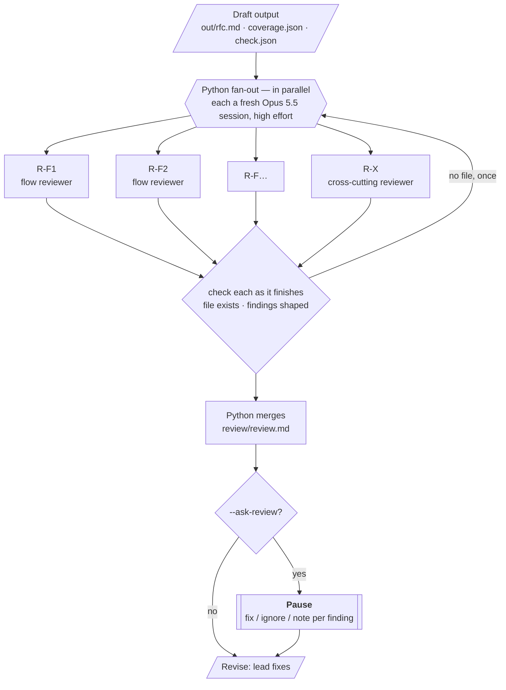

# Review

Review is an **independent check of the design against the code and the PRD**. Fresh reviewers — one per flow,
plus one cross-cutting — read the finished RFC (`out/rfc.md`, after Draft's gate), verify its claims in the
code, and write findings. Revise has the lead fix them.

**Run it** (after Draft):

```
/rfc-agent:review --run-dir <run dir> [--ask-review]               # in Claude Code: progress + triage here
uv run python -m rfc_agent.review --run-dir <run dir> [--ask-review] [--fresh]
```

Code: `src/rfc_agent/review/` — `cli.py` (fan-out, retry, merge, triage) · `review.py` (parse, check, merge) ·
`prompts/`. It reuses Investigate's runner, hook (write confinement, write-time citation checks, budget nudge),
progress and pauses. Tests: `tests/rfc/test_review.py` (including an end-to-end run with a fake `claude`: a
reviewer that crashes once is retried; the triage pause in file mode with a per-finding note).

---

## Contents

1. [Shape](#shape)
2. [Reviewers](#reviewers)
3. [What each reviewer reads](#what-each-reviewer-reads)
4. [Prompts](#prompts)
5. [Finding format](#finding-format)
6. [Checks](#checks)
7. [The merged review](#the-merged-review)
8. [The optional pause](#the-optional-pause)
9. [Configuration](#configuration)
10. [Models, tools and containment](#models-tools-and-containment)
11. [Output](#output)
12. [Progress](#progress)
13. [Failure handling and edge cases](#failure-handling-and-edge-cases)
14. [Handoff to Revise](#handoff-to-revise)

---

## Shape



**Independence:** every reviewer is a **fresh session** — never the lead's — and never sees the lead's reasoning
or its synthesis (`work/understanding.md`). Seams and blast radius are re-derived from the code and the
tracers' facts, so the review can catch what the lead missed rather than repeat it.

**Orchestration:** Python runs the reviewers as separate `claude -p` processes in parallel (Investigate's
runner), with per-reviewer timeouts and a retry for a reviewer that crashes or writes nothing.

---

## Reviewers

**Count:** one per flow in `flows.json`, plus one cross-cutting reviewer (e.g. 4 flows → 5 reviewers).
Wall-clock is about the slowest reviewer.

| | Flow reviewer `R-<flow>` | Cross-cutting reviewer `R-X` |
|---|---|---|
| **Focus** | Its flow's design section §4.n, the contract endpoints that flow touches, its CHANGE blocks, its REQs | The document as a whole |
| **Checklist** | 1. **Grounding** — spot-check the section's claims about current code, response shapes first. 2. **Blast radius** — every caller of anything it changes, **in any in-scope repo**. 3. **Implementability** — can each of its CHANGEs be built as written; are signatures consistent with how they're called? 4. **Requirements** — are its REQs' must-haves, in the PRD's words, actually met? 5. **UI** — does the design produce every state its screens show? | 1. **Seams between flows** — each flow's outputs vs. what the next flow / the UI expects. 2. **Consistency** — coverage table vs. design vs. contract vs. plan vs. open questions. 3. **Options → Recommendation** — are the options genuinely different; does the recommendation follow? 4. **Rollout & monitoring** — can each step be tested as described? 5. **The gate's known issues and flags** (`out/check.json`) — confirm or dismiss each |
| **Writes** | `review/R-<flow>.md` | `review/R-X.md` |

Overlap between a flow reviewer and the cross-cutting reviewer is expected to be small (different focus); any
duplicate is left to the lead to merge in Revise, since it fixes them anyway.

---

## What each reviewer reads

| Input | Flow reviewer | Cross-cutting |
|---|---|---|
| `out/rfc.md` | whole document; focuses on its parts | whole document |
| `out/coverage.json`, `out/check.json` (known issues, flags) | — | ✅ first |
| `work/reqs.json` (with PRD quotes), `raw/prd.md` | ✅ | ✅ |
| `work/flows.json` | its flow | all |
| `facts/T*.md` (tracer evidence) | the tracer(s) covering its flow | all |
| `facts/ui-*.md` | its flow's blocks | all |
| `work/understanding.md`, the lead's streams | ❌ never | ❌ never |
| Code: `_snap/<repo>` (Read / Grep / Glob) + fleetlens callers and endpoints | all in-scope repos (callers can live anywhere) | all in-scope repos |

---

## Prompts

The prompts are in [src/rfc_agent/review/prompts/](../src/rfc_agent/review/prompts):
`flow_reviewer.md`, `cross_reviewer.md` and `finding_format.md`.

**Flow reviewer.** Told it did not write the RFC and must find what is wrong, missing or unbuildable —
verified in the real code — not restyle it. It is given its flow, its section, its CHANGE blocks and REQs, and
the sources listed above. It runs the five checks in the table, writes `review/R-<flow>.md` findings only, most
severe first, with a concrete failure scenario for each. If the section is sound, it says so in one line and
writes no findings.

**Cross-cutting reviewer.** Told to find what is wrong *between* the RFC's parts. It looks at `out/check.json`
first, then runs its five checks, and writes `review/R-X.md`.

Both cite code as `repo/path:line`; citations are checked as they write.

---

## Finding format

Markdown, with one fixed structure Python relies on: the `### <SEVERITY>: <claim>` heading.

```markdown
## Review — F1 Create patient            (or: ## Review — cross-cutting)

### BLOCKER: the edit response double-nests the patient
- Evidence: patient_service/app/managers/patient/patient_manager.py:371 returns {"patient": …}; §5 says
  the response is flat
- Failure scenario: a user renames a patient → mweb reads res.data.name → undefined → a blank row
- Fix: add "action" to the existing dict instead of re-wrapping (§4.2 step 3, CHANGE-4)

### MAJOR: …
### MINOR: …

Verdict: 1 blocker, 2 major, 1 minor
```

| Severity | Means |
|---|---|
| **BLOCKER** | Building it as written breaks something, loses data, or fails a must-have REQ |
| **MAJOR** | Will cause rework: a gap, an inconsistency, an unhandled caller or state |
| **MINOR** | Clarity or completeness that doesn't change what gets built |

---

## Checks

Liberal, as everywhere in the pipeline. Citations in a reviewer's file are checked **at write time** by the
agent hook (the same write-time check as Investigate and Draft), so a reviewer fixes a wrong `path:line` as it
writes.

| Check | Result |
|---|---|
| `review/R-*.md` exists | **Must pass** — one retry if a reviewer crashes or writes nothing |
| Each finding has Evidence, a Failure scenario and a Fix | **Flag** — listed in the merged review |
| Evidence citations resolve (final check after the write-time hook) | **Flag** — the finding is marked *evidence unverified* in the merged review |
| A finding heading without a recognised severity | **Flag** — counted as MINOR |

---

## The merged review

Python writes `review/review.md`:

1. A summary table — reviewer × BLOCKER / MAJOR / MINOR, plus totals.
2. Each reviewer's section, unchanged, in order: cross-cutting first, then flows.
3. Flags from the checks (findings missing evidence, unverified evidence).

Findings get stable ids for Revise and the pause: `R-F1.1`, `R-F1.2`, `R-X.1`, … (reviewer + position).

---

## The optional pause

`--ask-review` (config `REVIEW.ASK`), **off by default**.

- **On:** every finding is shown as a selection — **BLOCKER and MAJOR pre-ticked, MINOR unticked**. Untick to
  ignore it; a note per finding (*"disagree: the BFF already strips this"*) goes to the lead with it (file
  mode: `"notes": {"R-F1.2": "…"}`; terminal: `n <number> <text>`). Same mechanism as the other pauses
  (selection questions under the Claude Code command, the numbered list in a terminal, files in between).
- **Off:** every BLOCKER and MAJOR goes to Revise; MINORs are listed for the lead to apply if cheap.

---

## Configuration

`~/.config/rfc-agent/config.json`, section `REVIEW`:

| Key | Default | |
|---|---|---|
| `MODEL` / `EFFORT` | `claude-opus-5-5[1m]` / high | per reviewer |
| `TIMEOUT_S` | 1200 | per reviewer |
| `CALL_BUDGET` | 150 | hook sends one "wrap up and write your findings" at this count |
| `ASK` | false | the optional pause (`--ask-review`) |
| `CROSS_CUTTING` | true | run R-X |

---

## Models, tools and containment

| | |
|---|---|
| Model | Opus 5.5, **high** effort, 1M context |
| Built-in tools | `Read`, `Grep`, `Glob`, `Write`, `Edit` — no Bash, no Agent, no web |
| MCP | strict config with only the context layer (fleetlens), read-only tools |
| Writes | only its own `review/R-*.md` (hook) |
| Citations | checked at write time (hook) |

---

## Output

| Path | Contents |
|---|---|
| `review/R-<flow>.md`, `review/R-X.md` | Each reviewer's findings |
| `review/review.md` | Merged review: summary table, all findings with ids, flags |
| `review/triage.json` | Only with `--ask-review`: per finding fix / ignore + note |
| `logs/review.json` | Per reviewer: time, cost, tool calls, rate-limit events, retries; counts per severity |
| `logs/review.R-*.stream.jsonl` | Raw streams |

---

## Progress

Milestones relayed by the Claude Code command (no live feed):

- *"Review: 5 reviewers running (R-F1, R-F2, R-F3, R-F4, R-X)"*
- *"R-F2 done (7m10s, $1.40): 1 blocker, 1 major"* — one line per reviewer as it finishes
- *"Review: 2 blockers, 4 major, 3 minor → Revise"* — or the pause, with `--ask-review`

---

## Failure handling and edge cases

| Case | Behaviour |
|---|---|
| A reviewer crashes / times out / writes nothing | Retried once alone; still nothing → its part is listed in the merged review as **not reviewed**; the others are unaffected |
| A reviewer finds nothing | One line "sound" and no findings — fine |
| A flow was `UNTRACED` in Investigate | Its reviewer is told so: it traces the essentials itself (budget permitting) and says what it could not verify |
| Same issue found by a flow reviewer and R-X | Both kept; the lead merges duplicates in Revise |
| Reviewer disagrees with a gate known issue | R-X dismisses it with one line; Revise sees the dismissal |
| Rate-limit throttling with many parallel reviewers | Logged per reviewer; if it shows up, run fewer in parallel |
| Run interrupted | Rerun resumes: finished reviewers are kept |

---

## Handoff to Revise

Revise gets `review/review.md` (and `review/triage.json` if the pause ran). The lead, resumed (warm), fixes the
findings in `out/rfc.md` / `out/coverage.json` with write-time citation checks, then Draft's gate re-runs, and
the **same reviewers are resumed** to confirm their own findings are resolved. Anything still unresolved is
published in a *"⚠ Unresolved review findings"* section rather than blocking the run. See
[REVISE.md](REVISE.md).
