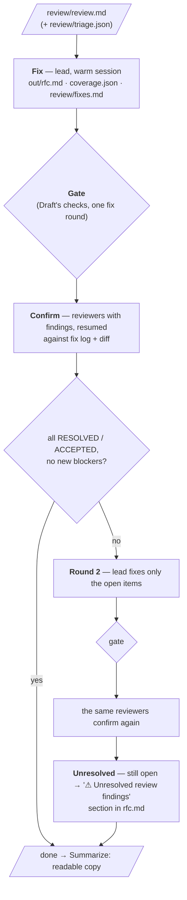

# Revise

Revise resolves the review's findings: the lead fixes them (or disagrees, with evidence), Draft's gate
re-checks the RFC, and the **same reviewers confirm their own findings**, for up to two rounds. Anything still
open goes into a visible *"⚠ Unresolved review findings"* section. A run always ends with an RFC.

**Run it** (after Review):

```
/rfc-agent:revise --run-dir <run dir>                        # in Claude Code: progress relayed here
uv run python -m rfc_agent.revise --run-dir <run dir> [--fresh] [--no-readable]
```

Code: `src/rfc_agent/revise/` — `cli.py` (rounds) · `fixlog.py` (parsing, statuses, the ⚠ section) · `prompts/`
(`fix.md`, `confirm.md`). The gate is Draft's (`--check-only`); reviewers are resumed from the session ids
Review saves. Tests: `tests/rfc/test_revise.py` (including a two-round run with a fake `claude`: a fix, a rejected
disagreement, a new BLOCKER raised in round 1 and resolved in round 2, and the ⚠ section).

---

## Contents

1. [Shape](#shape)
2. [Which findings](#which-findings)
3. [The lead fixes](#the-lead-fixes)
4. [The gate](#the-gate)
5. [Reviewers confirm](#reviewers-confirm)
6. [Round 2](#round-2)
7. [Unresolved findings](#unresolved-findings)
8. [Finding statuses](#finding-statuses)
9. [Configuration](#configuration)
10. [Output](#output)
11. [Progress](#progress)
12. [Failure handling and edge cases](#failure-handling-and-edge-cases)
13. [Handoff to Summarize](#handoff-to-summarize)

---

## Shape



```
review findings ──► round 1: lead fixes (fix log) → gate → reviewers confirm (fix log + diff)
                     ├─ all resolved / accepted, no new blockers ──────────► Summarize (readable copy)
                     └─ some NOT RESOLVED, or new BLOCKERs in changed parts
                   round 2: lead fixes only those → gate → the same reviewers confirm again
                     └─ anything still open → "⚠ Unresolved review findings" section ──► Summarize
```

---

## Which findings

| Triage ran (`--ask-review` in Review) | No triage |
|---|---|
| Every finding ticked **fix**, with its note (e.g. *"disagree: svc_a never edits"*) | Every **BLOCKER** and **MAJOR** |
| Unticked findings: listed to the lead as *ignored by the human* — not fixed, not confirmed | **MINOR**s: listed as *apply if cheap* — no fix-log entry required, not confirmed |

Findings in parts marked **not reviewed** (a reviewer that failed twice) can't be fixed here; they are carried
to the ⚠ section as *"not independently reviewed"*.

---

## The lead fixes

| | Rule | Why |
|---|---|---|
| **Who** | The lead, resumed (same session as Investigate and Draft; a fresh lead that reads the files if it can't be resumed) | It wrote the design and knows why each choice was made — a fix is an edit, not a rewrite |
| **Edits** | `out/rfc.md` and `out/coverage.json`, in place. Citations checked at write time (hook) | |
| **Consistency** | A change to the design must be carried into every part it affects: the flow's §4 section, the §5 contract, the §6 CHANGE blocks, coverage, §8 | Contradictions *between* parts are the typical result of a partial revision |
| **Disagreeing** | Allowed, **with evidence**: a code citation or a PRD quote | Reviewers can be wrong too; evidence keeps it honest |
| **Fix log** | `review/fixes.md` — one entry per finding id | Reviewers confirm against it; humans see what happened to each finding |

Fix log format — the `### <id> <STATUS>` heading is what Python relies on:

```markdown
## Round 1

### R-F1.1 FIXED
- Changed: §4.2 step 3 and CHANGE-4 set result["action"] on the existing dict; §5 edit response now
  {"patient": {…}, "action": "updated"}

### R-F1.2 DISAGREE
- Why: svc_a's edit path never calls this route — it uses PUT /v2/patients (svc_a/app/managers/patient.py:287)

### R-X.3 OPEN
- Added Q5 to §8: who owns the BFF passthrough
```

| Lead status | Meaning |
|---|---|
| `FIXED` | Changed the RFC; says what and where |
| `DISAGREE` | Didn't change it; why, with a citation or PRD quote |
| `OPEN` | Turned into an open question in §8 (with its id) — for findings that need a human decision |

The prompt is [prompts/fix.md](../src/rfc_agent/revise/prompts/fix.md). It lists the findings (id · severity ·
claim) and any triage notes, and asks for one fix-log entry per finding under `## Round <N>`. MINOR findings:
apply if cheap, no entry needed.

---

## The gate

Draft's gate runs again on the fixed RFC (coverage, structure, CHANGE blocks, secrets, Mermaid lint, citations
as a final assertion), with its own single fix round; the coverage table and References are re-rendered. Same
code as `draft --check-only`.

---

## Reviewers confirm

| | Rule |
|---|---|
| **Who** | Only the reviewers that had findings in this round — **resumed** (same session: they keep their context and evidence). A fresh reviewer with its review file if the session can't be resumed |
| **Input** | Its own findings, the lead's fix-log entries for them, and **the diff of `out/rfc.md`** (Python computes it — not the whole document again) |
| **Verdicts** | Per finding: **RESOLVED** · **NOT RESOLVED** (why) · **ACCEPTED** (the lead's disagreement or open question holds) |
| **New findings** | **Only new BLOCKERs, only in the changed parts** — so confirmation can't restart a full review |
| **Writes** | `review/<R-id>.confirm.md` (round 2: `.confirm2.md`); citations checked at write time |

```markdown
## Confirm — R-F1 (round 1)

### R-F1.1 RESOLVED
- §4.2 step 3 now keeps the existing dict (diff lines 212-219)

### R-F1.2 NOT RESOLVED
- The lead cites PUT /v2/patients, but svc_a/app/managers/patient.py:169 also calls POST …/patients — the create
  path is still affected

### NEW BLOCKER: the new "action" key breaks diagnostics' strict schema
- Evidence: diagnostics/schemas/patient.py:40 (extra="forbid")
- Failure scenario: …
- Fix: …
```

The prompt is [prompts/confirm.md](../src/rfc_agent/revise/prompts/confirm.md): for each of the reviewer's own
findings, check the fix-log entry and the diff (verify in the code where it matters), then write the verdicts.

---

## Round 2

Up to **two** fix → confirm rounds (`REVISE.ROUNDS`).

| Triggers round 2 | Doesn't |
|---|---|
| A finding marked **NOT RESOLVED** | RESOLVED, ACCEPTED |
| A **new BLOCKER** raised in the changed parts | MINORs |
| A lead `OPEN` the reviewer calls a dodge (NOT RESOLVED) | Findings the human ignored at triage |

Round 2 is narrower: only the open items, only the reviewers who raised them, only the latest diff. A
disagreement the reviewer didn't accept can be re-argued once in round 2; if they still disagree, it is
published with **both positions**.

---

## Unresolved findings

After the last round, Python renders a section into `out/rfc.md`, just before §8 Open questions, **only if
something is unresolved**:

```markdown
## ⚠ Unresolved review findings
| id | severity | finding | reviewer's position | lead's position |
|---|---|---|---|---|
| R-F1.2 | BLOCKER | create path still affected | svc_a/…/patient.py:169 calls POST … | svc_a uses PUT /v2 … |
| R-F3 | — | not independently reviewed (reviewer failed twice) | — | — |
```

Then the run continues — the section is the honest record for the humans who review the RFC. It is idempotent
(a rerun replaces it).

---

## Finding statuses

`review/status.json` — one entry per finding, the final state and the round it settled in:

| Status | Set when |
|---|---|
| `fixed` | Lead FIXED and reviewer RESOLVED |
| `accepted_disagreement` | Lead DISAGREE and reviewer ACCEPTED |
| `open_question` | Lead OPEN and reviewer ACCEPTED |
| `unresolved` | Still NOT RESOLVED after the last round, or the lead gave no entry |
| `ignored` | Unticked at triage |
| `minor_noted` | MINOR without triage — not tracked |
| `not_reviewed` | Its part had no review |

New BLOCKERs raised during confirmation get ids `<R-id>.N<k>` (e.g. `R-F1.N1`) and go through the same states.

---

## Configuration

`~/.config/rfc-agent/config.json`, section `REVISE`:

| Key | Default | |
|---|---|---|
| `ROUNDS` | 2 | fix → confirm rounds |
| `LEAD_TIMEOUT_S` / `CONFIRM_TIMEOUT_S` | 1200 / 600 | |
| `MINORS` | `apply_if_cheap` | `apply_if_cheap` \| `fix` \| `skip` |

Models: the lead's (Investigate) and the reviewers' (Review) — the same sessions are resumed.

---

## Output

| Path | Contents |
|---|---|
| `out/rfc.md`, `out/coverage.json` | Fixed in place; ⚠ section only if something is unresolved |
| `review/fixes.md` | The lead's fix log, per round |
| `review/<R-id>.confirm.md`, `.confirm2.md` | Each reviewer's confirmation |
| `review/rfc.round<N>.diff` | The diff each confirmation was based on |
| `review/status.json` | Final status per finding |
| `logs/revise.json` | Per round: time, cost, findings fixed / disagreed / opened, confirmations, gate result |

---

## Progress

Milestones relayed by the Claude Code command (no live feed):

- *"Revise: fixing 6 findings (2 blocker, 4 major)"*
- *"Fix log: 5 fixed, 1 disagree · gate clean · confirming with R-F1, R-X"*
- *"Round 1: 5 resolved, 1 disagreement accepted, 1 not resolved → round 2"*
- *"Revise done: all resolved"* — or *"… 1 unresolved (published in the ⚠ section)"*

---

## Failure handling and edge cases

| Case | Behaviour |
|---|---|
| No findings to fix (clean review, or all ignored at triage) | Revise is skipped; `status.json` is still written |
| Lead's session can't be resumed | Fresh lead that reads `out/rfc.md` and `review/review.md` first |
| Lead leaves a finding without a fix-log entry | Treated as NOT RESOLVED for that round (no confirmation needed) |
| A reviewer's session can't be resumed | Fresh reviewer with its review file, its findings, the fix log and the diff |
| A reviewer fails to write its confirmation (twice) | Its findings are `unresolved` with "confirmation failed" |
| The fix breaks the gate | The gate's own fix round; leftovers become gate known issues (shown in the ⚠ section) |
| A new BLOCKER appears in round 2's confirmation | No round 3 — published as unresolved |
| Run interrupted | Rerun resumes from the last finished step of the current round |

---

## Handoff to Summarize

At the end, Revise runs Summarize automatically (`--no-readable` skips it): a concise, human-readable copy of
the final RFC, `out/rfc.readable.md` — see [SUMMARIZE.md](SUMMARIZE.md).
