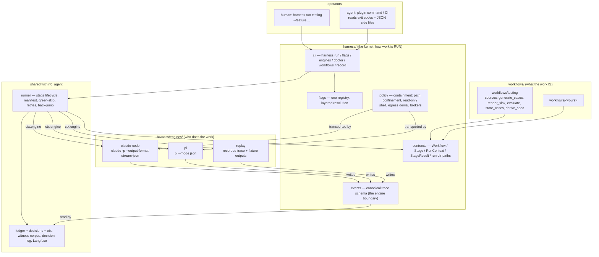
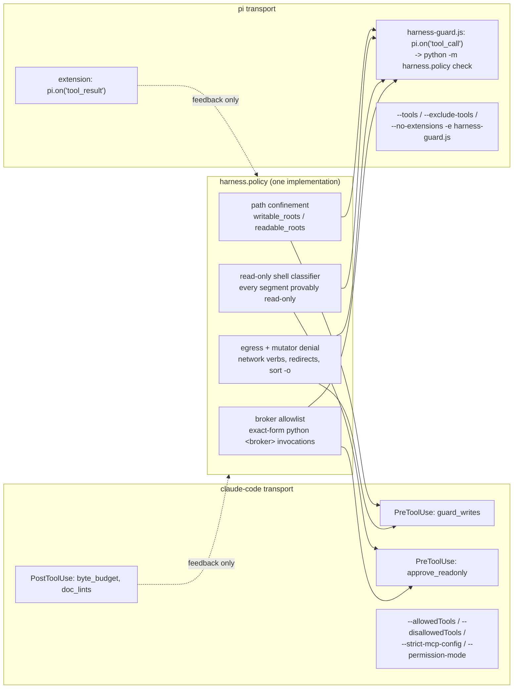

# Harness architecture

Vocabulary used throughout: **harness / kernel** = `src/harness/` (workflow-agnostic, engine-agnostic);
**workflow** = `src/workflows/<name>/` (an ordered set of stages plus its input, decision and flag vocabulary);
**engine** = an adapter that runs one headless agent invocation under a containment policy; **stage** = one
engine invocation (or a fan-out of them) with a `requires`/`outputs` file contract and a deterministic gate.

---

## 1. Layers



Dependency rule: **nothing under `harness/` imports `workflows`.** The run loop (`rfc_agent.runner`), the
ledger, decisions, observability and config currently live in `rfc_agent`, and the harness reaches them
through explicit, documented seams in `harness/cli.py`.

The edges that matter:

| Edge | Contract | Enforced by |
|---|---|---|
| workflow → kernel | expose exactly one `WORKFLOW: harness.contracts.Workflow` from `src/workflows/<name>/__init__.py` | `harness.workflows` package scan |
| kernel → engine | `Engine` protocol: `run(EngineRequest) -> EngineResult`, `supports_resume()`, `doctor()` | `harness.engines.Engine` |
| engine → kernel | write every declared output; return a `StageResult`; write `logs/<label>.events.jsonl` | `Stage.engine` docstring in `contracts.py` |
| kernel → operator | run dir + exit codes + `flags.json` + `manifest.json` + `logs/decisions.jsonl` | §2, §8 |

---

## 2. The run directory is the API

The run directory is the only interface between stages, and between the harness and anything watching it.
Stages never pass Python objects to each other. A stage declares `requires` (run-dir-relative files that must
exist before) and `outputs` (files that must exist after), and the runner enforces both. This is what makes a
stage resumable, gateable and engine-agnostic: a different engine, or a human with an editor, can satisfy the
same contract.

Consequences that are deliberately load-bearing:

- **Path shapes are contracts, not f-strings.** `stream_path`, `rotated_stream_path`, `stream_paths`,
  `ledger_path` and `guidance_path` live in `harness/contracts.py`; `events_path` / `events_paths` in
  `harness/events.py`. Rotation, rerun hygiene and the witness gate agree on what a trace file is called only
  because they call the same function.
- **Fan-out namespacing is by label.** One writer per trace file; a fan-out stage gives every child its own
  label, hence its own `logs/<label>.events.jsonl`. This is why the witness gate can glob
  `<stage>.*.events.jsonl` and see every shard.
- **Side effects stay inside the run directory.** Operator-machine effects (desktop-app relaunch,
  notifications, memory promotion to `~/.config/`) are flags, off by default for the harness.

Run-dir tree (workflow-agnostic parts; each workflow adds its own artifact directories):

```
<run_dir>/
  inputs.json          resolved CLI inputs (workflow-defined keys)
  flags.json           every resolved flag + which layer won
  identity.json        workstream / session / run ids, run_count
  manifest.json        per-stage accounting (atomic + fsync)
  guidance/<stage>.md  per-invocation gate/human feedback (wiped at invocation start)
  logs/
    <label>.events.jsonl      canonical trace — THE engine boundary
    <label>.stream.jsonl      engine-native trace (claude-code only)
    <label>.stderr, <label>.settings.json, <label>.mcp.json
    <stage>.ledger.json, <stage>.witness.txt
    decisions.jsonl, operator_actions.jsonl, asks_skipped.jsonl, operator_wait.jsonl
    steer.inbox.jsonl, steer.delivered.jsonl
    activity.log              unified live feed
    .attempt.<stage>.json     crash-intent breadcrumb
```

---

## 3. Stage lifecycle

```mermaid
sequenceDiagram
  participant CLI as harness cli
  participant R as runner
  participant S as stage (workflow)
  participant E as engine adapter
  participant G as gate (workflow)

  CLI->>R: run_pipeline(workflow, stages, flags, ctx)
  R->>R: wipe guidance/*.md, load manifest, identity, open obs trace
  R->>R: _reconcile_dead_attempt (crash breadcrumb from last run)
  loop per stage
    R->>R: inputs digest (sha256 over earlier stages' outputs + workflow.input_roots)
    alt green + digest unchanged + outputs on disk
      R->>R: decision GREEN_SKIP, next stage
    end
    R->>R: check requires -> EngineFailure if missing
    R->>R: seed guidance from red manifest (REVISE_IN_PLACE / BACK_JUMP)
    loop attempt <= budget
      R->>R: revising? rotate traces : unlink outputs + traces + witness
      R->>R: write logs/.attempt.<stage>.json (crash intent)
      R->>S: stage.engine(stage, ctx)  [or the run's default engine]
      S->>E: ctx.engine.run(EngineRequest(...))  (once, or N times for fan-out)
      E-->>S: EngineResult(summary, duration, engine_desc) + logs/<label>.events.jsonl
      S-->>R: StageResult
      R->>R: write_ledger(events_paths(run_dir, stage))
      R->>G: failures = missing outputs + stage.gate(ctx)
      alt failures and back-jump budget and retry_stage
        R->>R: guidance to retry_stage, decision BACK_JUMP, idx = index(retry_stage)
      else failures and same-stage budget
        R->>R: guidance; decision AUTO_RETRY_ON_GATE_FAILURE
      else failures all mechanical and one bonus left
        R->>R: decision BONUS_PATCH_RETRY
      else failures
        R->>CLI: GateFailure (exit 2)
      end
    end
    R->>R: record manifest (status, cost, attempts, inputs_digest, ledger stats)
    R->>S: ask_after(ctx) if interactive
    R->>R: boundary checkpoint (continue / rerun / quit -> RunStopped, exit 0)
  end
```

The run loop is `rfc_agent.runner.run_pipeline`.

**Guidance is the feedback channel.** `guidance/<stage>.md` is per-invocation, cleared at invocation start. The
runner writes gate failures into it; the engine folds it into the next prompt as authoritative guidance, plus
patch-mode and revision-mode addenda. Cross-stage feedback (a later stage's failure re-running an earlier one)
writes into the *target* stage's guidance file.

---

## 4. Canonical events: the engine boundary

**Every engine writes `logs/<label>.events.jsonl`; the ledger, crash accounting, live feed and observability
read that file and nothing else.**

The schema (`src/harness/events.py`) has ten event types: `init`, `text`, `thinking`, `tool_start`,
`tool_end`, `denial`, `user`, `compaction`, `result`, `log`. They are flat and additive, each with
`t` / `ts` / `seq` / `v`. Tool events carry a **normalised `kind`** (`read`, `search`, `list`, `write`,
`edit`, `shell`, `fetch`, `mcp`, `subagent`, `ask`, `other`), so the ledger classifies reads and writes
without knowing any engine's tool names. `summarize()` derives the engine-agnostic `TraceSummary` the
accounting layer wants, including the `reads` / `searches` / `writes` lists that seed the witness corpus.

Adopting one engine's wire format would force every other engine to forge its events. Ten neutral event types
plus one translator per engine is the smaller honest seam.

| Canonical event | claude-code source | pi source |
|---|---|---|
| `init` | `system`/`init`: `session_id`, `model`, `tools`, `mcp_servers` | first line `{"type":"session","version":3,"id":...,"cwd":...}` |
| `text` / `thinking` | `assistant` content blocks `text` / `thinking` | `message_end.message` content (authoritative); never `message_update` |
| `tool_start` | `assistant` block `tool_use` (`id`, `name`, `input`) | `tool_execution_start` (`toolCallId`, `toolName`, `args`) |
| `tool_end` | `user` block `tool_result` (`tool_use_id`, `content`) | `tool_execution_end` (`toolCallId`, `result`, `isError`) |
| `denial` | `permission_denied` event; `result.permission_denials[]` | extension `tool_call` handler returned `{block:true}` |
| `compaction` | `compact_boundary` | `compaction_start` / `compaction_end` with `reason` |
| `result` | `result`: `subtype`, `total_cost_usd`, `usage`, `num_turns`, `duration_ms` | terminal `agent_settled` + accumulated usage |
| `log` | stderr tail, respawn notes | `auto_retry_start`/`auto_retry_end`, stderr tail |

Two translation hazards, both written into the adapters:

1. **Pi's terminal event is `agent_settled`, not `agent_end`.** `agent_end` carries `willRetry`; treating the
   first one as terminal truncates runs.
2. **Pi's wire `message_update` is delta-only.** Tool arguments must come from `tool_execution_start`, never
   from `message_update`, and its `usage` may stay zero when the provider only reports at completion.

The claude-code adapter also writes the raw `logs/<stage>.stream.jsonl` beside the canonical trace, because
the existing ledger and witness code still reads it.

---

## 5. Engines

An engine is a **name**, resolved through flags, never a code edit:

```bash
harness run testing --feature F                               # flag `engine` default: claude-code
harness run testing --feature F --engine pi                   # whole run on pi
harness run testing --feature F --stage-engine evaluate=claude-code
harness run testing --feature F --engine replay --set replay.recording=<path>
```

`harness.engines.get_engine(name)` resolves lazily from a `{name: "module:factory"}` table, so importing the
kernel never imports an adapter's dependencies, and out-of-tree adapters register with
`register(name, factory)`. Stage-owned fan-out engines receive the resolved adapter as `ctx.engine` and **must
call it**.

Three adapters ship: `claude-code` (default, the `claude -p` primitive), `pi` (a `pi --mode json` subprocess)
and `replay` (re-emits a recorded trace for parity runs, benchmarks and offline tests). The per-engine
prerequisites, behaviour under the hood and known gaps are in [ENGINES.md](ENGINES.md).

The Claude Agent SDK is a possible third real adapter behind the same protocol. It is not adopted, because it
changes the concurrency model and the hook model at once, and it breaks `--settings`-materialised hooks and
steering-over-stdin. The trigger to revisit: the CLI's hook transport or steering-over-stdin breaks in a CLI
release, or the SDK demonstrates verified parity on strict-MCP subset, PreToolUse deny and session resume,
with a passing parity suite.

---

## 6. Containment: one policy, two transports

The **policy** is a library; the **transport** is per-adapter.



`Containment` (`engines/__init__.py`) is the engine-neutral carrier: `writable_roots`, `readable_roots`,
`allowed_tools`, `disallowed_tools`, `mcp_servers`, `strict_mcp`, `readonly_shell`, `hooks_enabled`,
`disabled_hooks`. The adapter's job is to express it in its own native mechanism, not to decide it.

The Pi extension shells out to `python -m harness.policy check` instead of porting the regexes: two copies of
the classifier would drift, and drift in a containment classifier is a security bug rather than a bug. A
~50 ms subprocess per tool call is cheaper than that risk. The Pi handler also fails safe by construction: a
crashing `tool_call` handler blocks the tool.

What containment does **not** claim to be: an OS sandbox. Bash containment is a deny-list over a read-only
allow-list, and the run directory is model-writable and holds the traces the witness gate reads. If you need
real isolation, run the harness in a container.

---

## 7. Flags

One registry, layered resolution, introspectable by humans and agents.

```
CLI      --set name=value / --enable name / --disable name
  >  env     the flag's declared env var, else HARNESS_<NAME_WITH_DOTS_AS_UNDERSCORES>
  >  config  the same dotted key in config.json
  >  workflow  a workflow may re-default a harness flag for its runs
  >  default   the Flag's declared default
```

Implementation: `src/harness/flags.py`. `Flag` carries `name`, `type`, `default`, `help`, `scope`
(`harness` / `engine` / `workflow` / `stage`), `env`, `choices` and `owner`. `resolve()` walks the layers in
that order and records **every layer that had an opinion**, which is what makes `--explain` honest.
`parse_cli_sets` rejects unknown names with the known list attached, so a typo is an error and never a
silently ignored toggle. Secret values are redacted in `flags.json`, including in the per-layer values.

| Command | Audience | Output |
|---|---|---|
| `harness flags` | human | table: name, type, default, scope, owner, env |
| `harness flags --json` | agent | the full registry with types, defaults and help |
| `harness flags --explain <name>` | human | every layer's value and which one won |
| `harness flags --workflow <name>` | both | only the flags that workflow registered |
| `<run_dir>/flags.json` | both, after the fact | what was actually in effect for that run |

Core flags: `engine`, `stage_engines`, `disabled_stages`, `hooks`, `hooks_off`, `hook_canary`, `retries`,
`back_jumps`, `revise_on_retry`, `resume_sessions`, `green_skip`, `obs`, `obs_required`, `interactive`,
`live_feed`, `keep_awake`, `model`, `stage_models`, `timeout_s`, `max_budget_usd`. Engine flags are
namespaced (`pi.*`, `replay.*`) and workflow flags are namespaced by workflow name (`testing.*`).

The three operations everyone asks about:

```bash
# turn a stage off
harness run testing --feature F --disable-stage render_xlsx
#   removal is recorded as a decision; the neighbours' requires/outputs contract still applies, so disabling a
#   stage whose outputs nobody else produces fails loudly

# swap the engine, globally or for one stage
harness run testing --feature F --engine pi
harness run testing --feature F --stage-engine evaluate=claude-code

# disable a hook (benchmarks only) or the whole transport
harness run testing --feature F --set hooks_off=byte_budget,doc_lints
harness run testing --feature F --disable hooks          # removes containment — the help text says so
```

---

## 8. Observability

The id model is `workstream_uuid ⊃ session_uuid ⊃ run_id ⊃ trace_id`, so a later stage's runs link to the run
that produced their inputs rather than floating free.

| Layer | Observation | Source |
|---|---|---|
| run | chain root `<workflow>-run` | runner, at invocation start |
| stage | chain `stage:<name>[#attempt]` | `obs.stage_span` |
| agent | `agent:<name>`, and `shard:*` / `persona:*` for fan-out children | engine adapter, via `EngineRequest.obs_parent` |
| model call | generation `llm:<stage>` with model, usage, cost | `EngineResult.summary` |
| tool | `tool:<Name>` (capped per stage) | canonical `tool_start` / `tool_end` events |
| gate | evaluator `gate:<stage>` with pass/fail + failures | runner, after the gate |
| decision | chain `decision:<name>` | `decisions.record` → `logs/decisions.jsonl` + obs |
| operator | chain `operator:*`, operator-wait accounting | ask layer |

Observability reads canonical events. Secret scrubbing is a Langfuse `mask_otel_spans` hook
(`rfc_agent/privacy.py`) and applies to every workflow. The RFC pipeline's own trace shape is in
[../OBSERVABILITY.md](../OBSERVABILITY.md).

---

## 9. Adding a workflow

A workflow is a folder, not a code edit.

```
src/workflows/<name>/
  __init__.py        exposes WORKFLOW: harness.contracts.Workflow  (the only required file)
  stages/
    <stage>/__init__.py   the Stage: requires, outputs, build_prompt, gate, engine?
    <stage>/SKILL.md      the persona staged for the engine invocation
  flags.py           harness.flags.define(Flag(...)) for every <name>.* toggle
```

Recipe:

1. **Declare the stages.** Each is a frozen `Stage` (`contracts.py`): `name`, `requires`, `outputs`,
   `build_prompt(ctx) -> str`, `gate(ctx) -> list[str]`. Everything else has a default.
2. **Declare the workflow**: `name`, `stages`, `default_pipeline`, `description`, `add_inputs(parser)`,
   `resolve_inputs(namespace) -> dict`, `flags`, `decisions`, `input_roots`.
3. **Register the flags**, namespaced `<name>.*`, each with help text.
4. **Register the decisions** the workflow may record beyond `CoreDecision`.
5. Nothing else. Discovery is a package scan: `harness workflows` lists it, `harness run <name>` runs it,
   `harness flags --workflow <name>` documents it.

### Worked example: the testing workflow

`src/workflows/testing/__init__.py` declares a pipeline of `sources → generate_cases → render_xlsx → evaluate →
store_cases → derive_spec` (and `execute_be` behind a flag). Every rule that would otherwise be prose in a
persona becomes a deterministic gate — ID patterns, scenario ↔ case linkage, mandatory columns, enum values,
module coverage — and the evaluator's rubric stays model-side (a hybrid gate). Storage is a `CaseStore`
protocol with `kiwi` and `json` backends chosen by `testing.storage`, so the workflow is testable without a
running Kiwi. Details: [src/workflows/testing/README.md](../../src/workflows/testing/README.md).

---

## 10. What is deliberately not in the kernel

| Not in the kernel | Where it lives | Why |
|---|---|---|
| Any notion of an RFC, a test case, a Figma file, a Jira key | `workflows/*` | A kernel that knows a domain is a framework for one workflow |
| Gate content (citation regexes, quote grounding, suite ID conventions) | workflow gates | Gates are the workflow's definition of done; only their *shape* (`ctx -> list[str]`) is kernel |
| Prompt text, personas, SKILL.md | workflow stage dirs | The kernel stages a persona file; it never authors one |
| The classifier that selects patch mode | workflow | It matches gate wording, and gate wording is workflow-owned |
| Model choice policy, effort ladders | flags + workflow defaults | A policy the operator must be able to change without a release |
| Async rewrite, in-process MCP, the Agent SDK | nowhere | Changes the concurrency and hook models at once; no benchmark shows a delta |
| Vector stores, graph memory, RAG | nowhere | The run directory plus the witness ledger is the memory |
| A DAG scheduler / conditional branching | nowhere | Pipelines are ordered lists whose coupling is files |
| Retry of the *engine* on provider errors | the adapter | Provider retry semantics are engine-native |
| An OS sandbox | nowhere | Run the harness in a container when isolation matters |
| Operator-machine side effects (desktop-app relaunch, notifications, memory promotion) | workflow, behind flags | A harness must not launch desktop apps by default |
| Secrets management | the operator's config + `harness.policy` egress denial | The kernel's job is not to leak them (`privacy.py`) |
