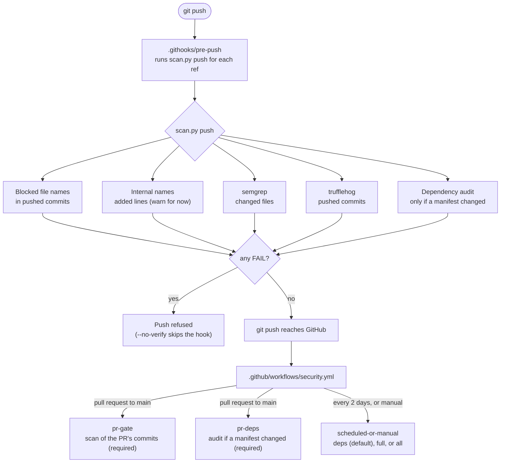
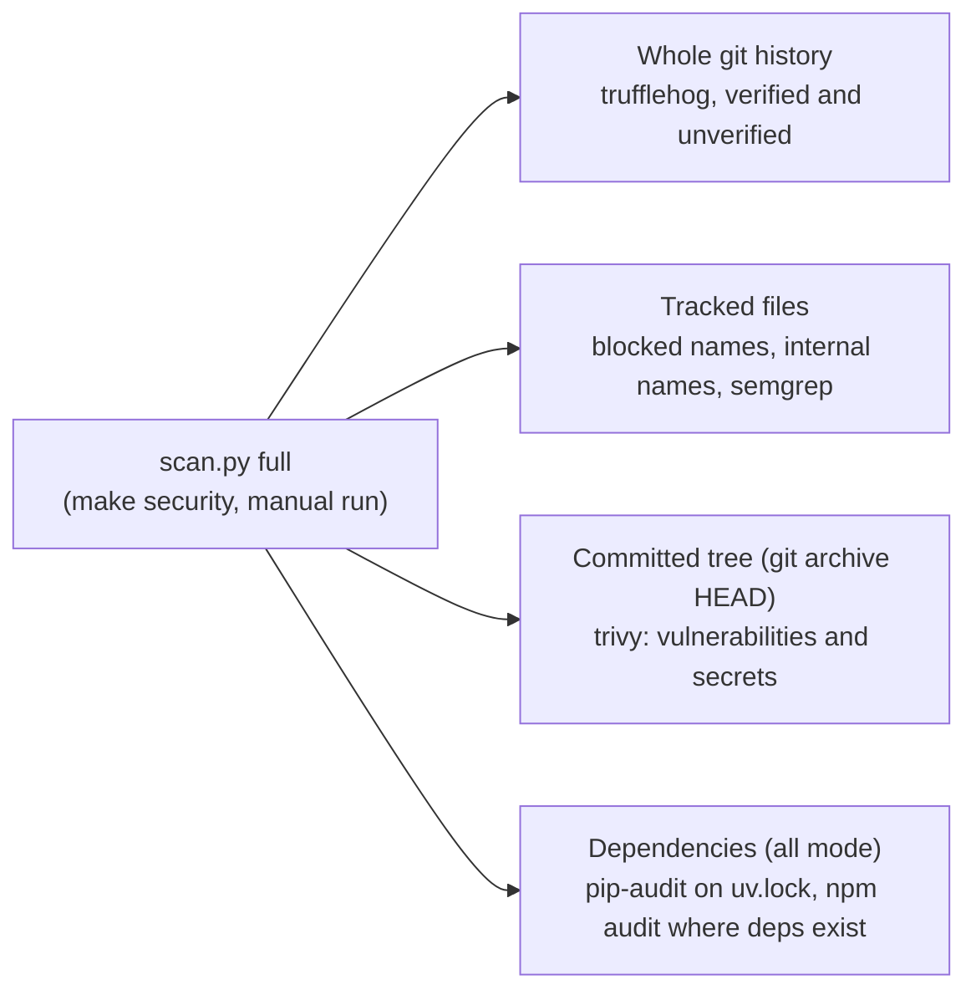

# Security pipeline

What runs when code moves, what each check covers, and what it blocks. The code is `scan.py`, its rules are in `policy.json`, and the deferred work is in `DEFERRED.md`.

## Flow: from a push to merge



## What a full scan covers

`full` is not part of the PR gate. It runs for `make security` and for a manual `workflow_dispatch` with mode `full`. It checks the whole repo, not only the new commits, so it is slow and is meant for the first merge to `main` and for periodic checks.



## What is covered

Three scopes are used below. **Hook** = the pre-push hook on your machine, on the commits you push. **PR gate** = the commits a pull request adds to `main`. **Full** = the whole repo and history, run manually with `make security` (or the manual workflow run with mode `full`). Full is not run on PRs.

| Check | Tool | Scope | Blocks on |
|---|---|---|---|
| Secrets in new commits | trufflehog 3.88.28 | hook: pushed commits; PR gate: PR commits | any secret, verified or not; reviewed fixtures in `policy.json` allowlist |
| Secrets in whole history | trufflehog 3.88.28 | full: every commit on every branch | same as above |
| Secrets in committed tree | trivy 0.70.0 (secret scanner) | full: `git archive HEAD` | HIGH/CRITICAL |
| Static security issues | semgrep 1.164.0, `p/secrets` + `p/security-audit` | hook and PR gate: changed files; full: all tracked files | ERROR; WARNING is reported only |
| Vulnerable Python packages | pip-audit 2.10.1 on the `uv export` pins | pr-deps (when a manifest changed), scheduled run, full | any known vulnerability |
| Vulnerable lockfile packages | trivy 0.70.0 (vuln scanner) | full: `git archive HEAD` | HIGH/CRITICAL |
| Vulnerable npm packages | npm audit | packages that declare dependencies (none today) | high/critical |
| Files that must never be committed | name rules in `policy.json` | hook and PR gate: changed files; full: all tracked files | any match |
| Internal names and personal paths | regex rules in `policy.json` | hook and PR gate: added lines; full: all tracked files | `fail` list once mode is `fail`; now `warn` |
| Tool presence | `scan.py` | every run | a missing scanner is a FAIL, never a silent pass |

**Blocked file names:** `.env`, `.env.*`, `*_oauth_token`, `*.token`, `/config.json` (root only), `runs/`, `out/`, `*.pem`, `*.key`, `*.p12`, `id_rsa*`.

## How to run it

```bash
make security           # full history, committed tree, and dependencies (all)
make security-deps      # dependency audits only
make install-hooks      # point git at .githooks/ (once per clone)
python3 scripts/security/scan.py push <base> <head>   # what the hook runs
```

## Allowlisting

Only reviewed fixtures go in `trufflehog_allow`. Each entry is the first 16 hex characters of the sha256 of the secret value. The scanner prints that id for every finding, so an entry can be added without ever printing the secret. Check that a value is fake before adding it.

## Not covered yet

See `DEFERRED.md` for the full list. The main gaps: the two current real findings (xlsx XML parsing and urllib3), the internal-name cleanup and its move to `fail`, unverified tool downloads, and the workflow not yet run on GitHub.

## Public-repo settings

Repo settings and additions for going public (branch protection, CODEOWNERS, LICENSE, root SECURITY.md, CodeQL, and others) are listed in `DEFERRED.md`.
